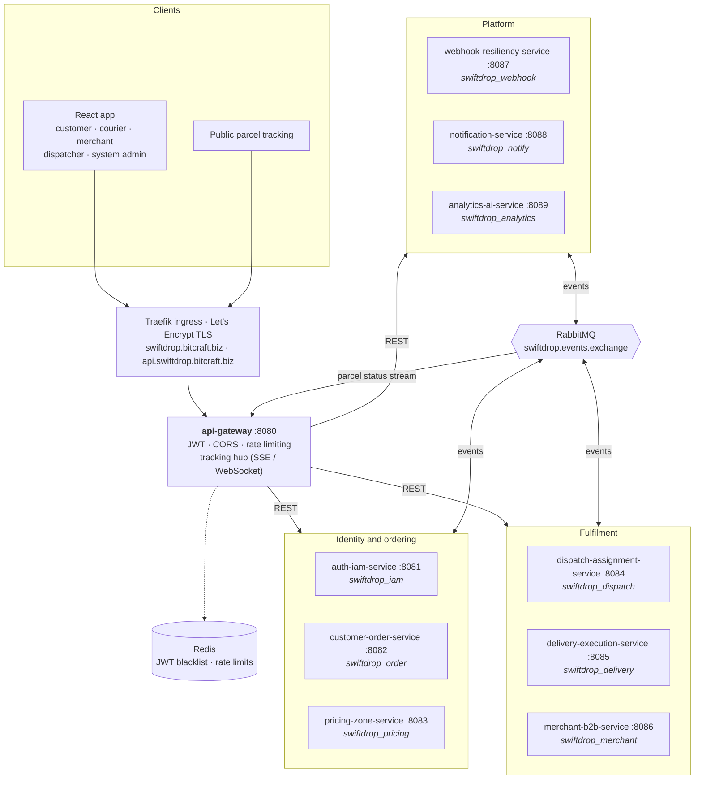
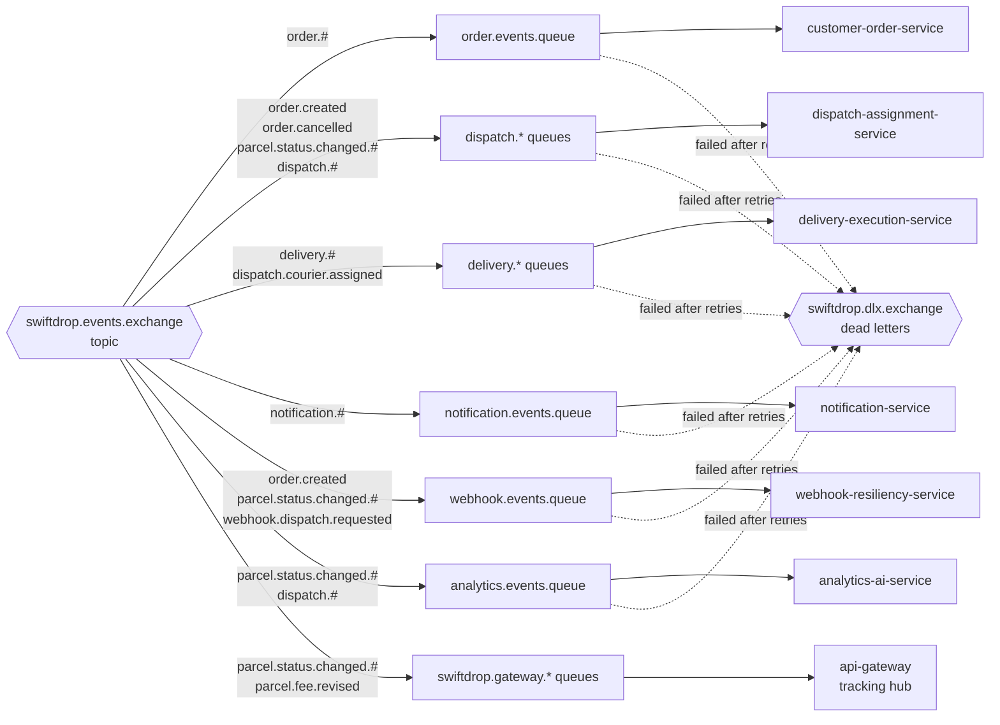
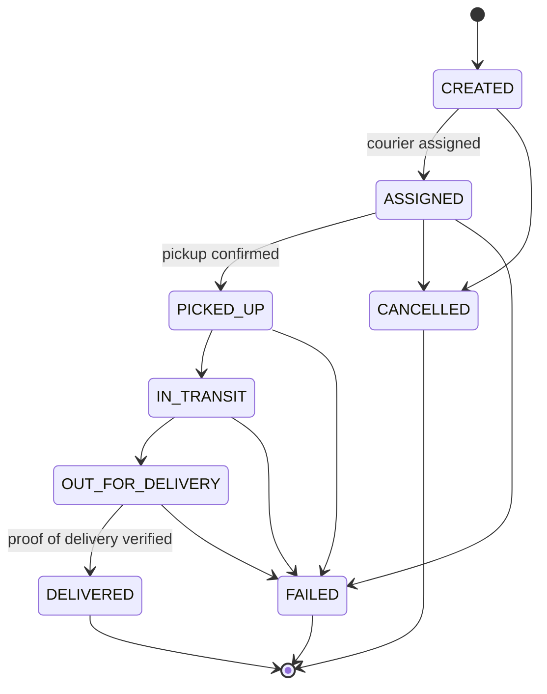
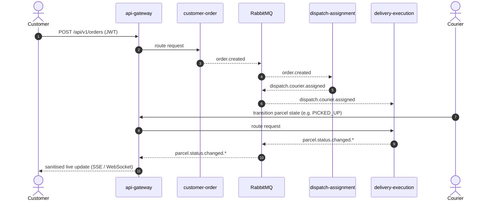
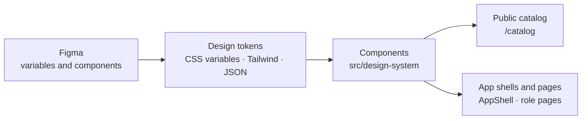
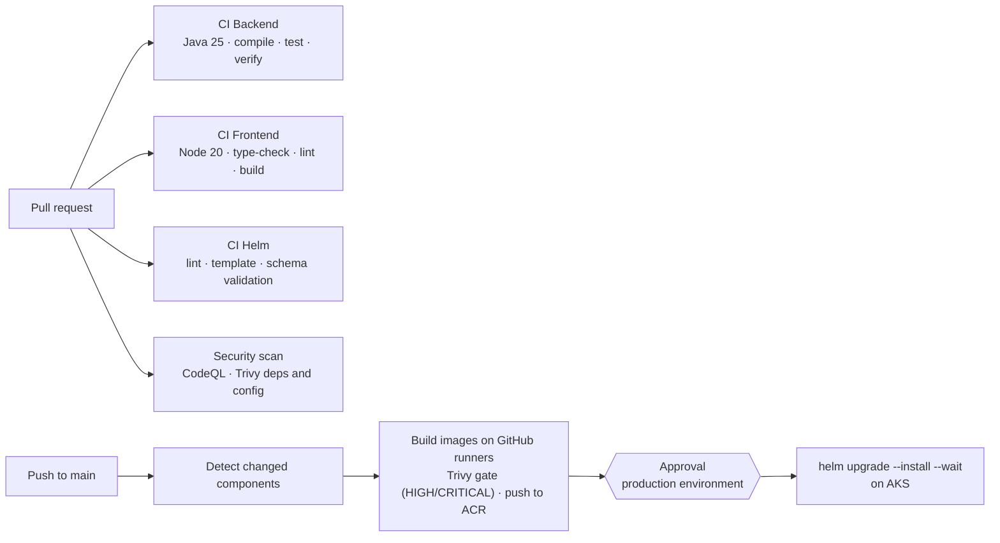

<div align="center">


# SwiftDrop

### Enterprise Logistics & Courier Management Platform

**Event-driven microservices monorepo • Azure Kubernetes Service • Database-per-Service**

**Live:** [swiftdrop.bitcraft.biz](https://swiftdrop.bitcraft.biz)

[](https://github.com/Shehan-Dinusha/BitCraft_SwiftDrop/actions/workflows/ci-backend.yml)
[](https://github.com/Shehan-Dinusha/BitCraft_SwiftDrop/actions/workflows/ci-frontend.yml)
[](https://github.com/Shehan-Dinusha/BitCraft_SwiftDrop/actions/workflows/cd-aks-deploy.yml)
[](https://github.com/Shehan-Dinusha/BitCraft_SwiftDrop/actions/workflows/security-scan.yml)


</div>

---

## Contents

[Overview](#overview) · [Live demo](#live-demo) · [Architecture](#architecture) · [Services and databases](#services-and-databases) · [Events](#event-driven-messaging) · [Parcel lifecycle](#parcel-lifecycle) · [Frontend](#frontend) · [Repository layout](#repository-layout) · [Run it locally](#run-it-locally) · [CI/CD](#cicd) · [Documentation](#documentation) · [Contributing](#contributing)

## Overview

SwiftDrop manages the full life of a courier parcel across Sri Lanka: booking, pricing, dispatch, pickup, delivery with proof of delivery, cash handling, notifications and analytics.

| | |
|---|---|
| **Backend** | Java 25, Spring Boot 3.5, Spring Cloud Gateway (reactive), nine servlet services, Flyway, SpringDoc OpenAPI 3.1 |
| **Messaging** | RabbitMQ topic exchange with dead-letter queues |
| **Data** | PostgreSQL, one physically separate database per service. Redis for JWT blacklist and rate limits |
| **Frontend** | React 18, TypeScript, Vite, Tailwind. One app for five roles, built on the SwiftDrop design system |
| **Platform** | Docker Compose locally; Azure Kubernetes Service (AKS) in production, deployed with a Helm chart behind Traefik and Let's Encrypt TLS |

## Live demo

| | |
|---|---|
| **App** | https://swiftdrop.bitcraft.biz (frontend, plus same-origin `/api` and `/ws`) |
| **API** | https://api.swiftdrop.bitcraft.biz (gateway only; `/actuator` is not exposed) |
| **Swagger UI** | https://api.swiftdrop.bitcraft.biz/swagger-ui.html (every service, one page) |
| **Runs on** | One AKS node (Standard_B4ms, Azure for Students): 10 Spring services, 9 PostgreSQL StatefulSets, RabbitMQ, Redis, the frontend |
| **Data** | A month of synthetic demo data from [`scripts/seed`](scripts/seed/README.md): about 120 accounts across every role and 240 parcels in every state |

Demo sign-ins are shared with the team in [docs/deployment/DEMO-ACCOUNTS.md](docs/deployment/DEMO-ACCOUNTS.md) and with assessors separately.

> [!NOTE]
> The cluster runs on a student subscription and is paused outside demo times to save credit, so the site may be offline. It is paused and resumed with `scripts/aks/pause.sh` / `resume.sh`, which back up and restore the databases.

## Architecture

Every bounded context owns its schema, lifecycle and data. Services never read each other's databases; they talk through the gateway (HTTP) and RabbitMQ (events).



> [!NOTE]
> The browser only ever talks to the gateway: `http://localhost:8080/api/v1/...` locally, and same-origin `/api/v1/...` on https://swiftdrop.bitcraft.biz. Downstream service ports are for local debugging, not for the frontend.

## Services and databases

| Service | Port | Database | Local DB port | K8s StatefulSet | Storage | Responsibility |
|---|---:|---|---:|---|---|---|
| `api-gateway` | 8080 | none (stateless) | n/a | n/a | n/a | Routing, JWT and header propagation, CORS, rate limiting, tracking hub |
| `auth-iam-service` | 8081 | `swiftdrop_iam` | 5431 | `iam-postgres` | 10Gi Std SSD | Authentication, identity, roles |
| `customer-order-service` | 8082 | `swiftdrop_order` | 5433 | `order-postgres` | 50Gi Prem SSD | Customer order lifecycle |
| `pricing-zone-service` | 8083 | `swiftdrop_pricing` | 5434 | `pricing-postgres` | 10Gi Std SSD | Pricing quotes, geofence zones |
| `dispatch-assignment-service` | 8084 | `swiftdrop_dispatch` | 5435 | `dispatch-postgres` | 20Gi Prem SSD | Courier availability and assignment |
| `delivery-execution-service` | 8085 | `swiftdrop_delivery` | 5436 | `delivery-postgres` | 50Gi Prem SSD | Delivery state machine, proof of delivery, delivery status events |
| `merchant-b2b-service` | 8086 | `swiftdrop_merchant` | 5437 | `merchant-postgres` | 50Gi Prem SSD | Merchant APIs, API keys, order ingestion |
| `webhook-resiliency-service` | 8087 | `swiftdrop_webhook` | 5438 | `webhook-postgres` | 30Gi Prem SSD | Webhook subscriptions, retries, dead-letter replay |
| `notification-service` | 8088 | `swiftdrop_notify` | 5439 | `notify-postgres` | 20Gi Std SSD | Notification preferences and logs |
| `analytics-ai-service` | 8089 | `swiftdrop_analytics` | 5440 | `analytics-postgres` | 50Gi Prem SSD | Operational KPIs, AI delivery assistant |

Storage sizes are the production Helm profile (Azure managed disks). The student profile used for the live demo gives every database a 2Gi `local-path` volume on the node's own disk, because a 4-vCPU VM can attach only 8 managed disks and SwiftDrop needs 11 volumes.

Shared event records, DTO wrappers, enums and security headers live in [`backend/common-contracts`](backend/common-contracts). See [ADR-001](docs/architecture/ADR-001-physical-db-statefulsets.md) for why every database is its own StatefulSet.

## Event-driven messaging

Services publish to one topic exchange, `swiftdrop.events.exchange`. Each consumer binds its own queue by routing key. Messages that keep failing are dead-lettered to `swiftdrop.dlx.exchange` (`dlq.*` queues) so nothing is silently lost.



The queue, exchange and binding definitions for local development are in [`infra/local/rabbitmq/definitions.json`](infra/local/rabbitmq/definitions.json). Keep that file, the owning `RabbitMQConfig.java` and the event records in `common-contracts` in sync.

## Parcel lifecycle

The delivery service owns the state machine. Only allowed transitions are accepted, and `DELIVERED` needs verified proof of delivery (a photo plus recipient name, or a signature).



Customers see a friendlier set of **nine public statuses**. They map one to one with the states above, with two differences: `ASSIGNED` is shown as `PICKUP_ASSIGNED`, and `RETURNED_TO_SENDER` exists only as a public status (the delivery state machine has no return state).

How a booking flows through the system:



## Frontend

One React app serves five roles. After sign-in, `AppShell` picks the matching layout: a side navigation and top bar on desktop, and a bottom tab bar on mobile for customers and couriers.

Public pages need no account: the landing page (`/`), parcel tracking (`/track`), sign-in and registration, and the design catalog (`/catalog`).

The app is an installable **PWA**, aimed at couriers and customers on phones: signed-in couriers and customers get an "Install SwiftDrop" prompt (on iPhone: Share → *Add to Home Screen*). The service worker caches only the app's own files, so it opens instantly on a weak signal; API responses are never cached. New versions wait for the user to tap *Reload*, so nobody is reloaded mid-delivery. PWA features only run in a production build (`npm run build && npm run preview`), not in `npm run dev`.

| Role | Density | Shell | Typical screens |
|---|---|---|---|
| Customer | Comfortable (44px controls) | Side nav, mobile tabs | Book, track |
| Courier | Kinetic (56px thumb targets) | Side nav, mobile tabs | Shift, active delivery |
| Merchant | Compact (34px) | Side nav | Dashboard, API keys, B2B orders, webhooks, registration |
| Dispatcher | Compact | Side nav | Control tower, dispatch board, webhook dead letters |
| System admin | Compact | Side nav | The ops area (`/ops`) plus merchant approvals, users, zone and tariff pricing, analytics dashboard, notification console |

### SwiftDrop design system

The UI is built from the **SwiftDrop** design system, which mirrors the [Figma file](https://www.figma.com/design/XX3u7zxTDat0l2MbG27niR/BitCraft-SwiftDrop-Web-Design--Copy-). The Figma file is the source of truth; the theme is **light only**.



- **Browse every component** at [`/catalog`](http://localhost:5173/catalog) once the frontend is running. It is public: no login and no backend needed. It is grouped like the Figma library, with a gallery that shows the shell of every role at desktop, tablet and mobile width.
- **Share the catalog as one file:** `npm run build:catalog` writes a single self-contained HTML file you can open from disk or send to someone.
- **Component rules and the full component map:** [`frontend/COMPONENTS.md`](frontend/COMPONENTS.md). Figma links: [`docs/design-system/figma-source.md`](docs/design-system/figma-source.md).

### Working on the frontend

```bash
cd frontend
npm install
npm run dev            # http://localhost:5173
npm run lint           # type-check
npm run build          # production build
npm run build:catalog  # single-file design catalog
npm run seed:demo      # create demo accounts per role (local only)
npm run api:sync:specs # regenerate API types from docs/api-specs
```

> [!TIP]
> No backend? Use **Continue in development mode** on the login page, then the *Dev persona* bar to switch roles. It uses a fake token, so API calls fail, but layouts and navigation work. For a real sign-in per role, run `npm run seed:demo`.

## Repository layout

```text
SwiftDrop/
├── backend/                     Maven reactor (Java 25, Spring Boot 3.5)
│   ├── common-contracts/        Shared events, DTOs, enums, headers
│   ├── api-gateway/             Routing, JWT, tracking hub
│   └── *-service/               Nine business services
├── frontend/                    Vite + React + TypeScript app
│   └── src/
│       ├── design-system/       Tokens, primitives, components, shells
│       ├── features/            customer · courier · merchant · admin-ops · auth · landing ·
│       │                        public-tracking · notifications · pricing · pwa · catalog
│       └── app/                 Router, AppShell, providers
├── infra/
│   ├── local/rabbitmq/          Queue, exchange and binding definitions
│   ├── helm/swiftdrop/          Helm chart for AKS (all services, DBs, broker, ingress)
│   └── cluster/                 One-time cluster add-on values (Traefik)
├── scripts/
│   ├── seed/                    Demo-data seeder (drives the public APIs) and timeshift
│   ├── db/                      AKS database backup / restore
│   └── aks/                     Pause / resume the student cluster without losing data
├── docs/                        API specs, ADRs, deployment guides, design system, brand assets
├── .github/workflows/           CI and CD pipelines
├── docker-compose.yml           Local infrastructure and optional app containers
└── .env.example                 Environment variable template
```

## Run it locally

**Prerequisites:** Java 25, Maven 3.9+, Node.js 20+, Docker Desktop. For Kubernetes, also Helm 3.

There are two ways to run SwiftDrop on your machine:

| | Option A: Docker Compose | Option B: Kubernetes (Docker Desktop) |
|---|---|---|
| Best for | Day-to-day feature work and debugging one service | Trying the real deployment: same Helm chart as production |
| What runs | Infrastructure in containers; services from your IDE or Maven | Core set (gateway, auth, order, pricing, frontend) in Kubernetes |
| URLs | `localhost:5173`, `localhost:8080` | `swiftdrop.localhost`, `api.swiftdrop.localhost` |

### Option A: Docker Compose

```bash
# 1. Configure
cp .env.example .env

# 2. Start infrastructure (RabbitMQ, Redis and the 9 PostgreSQL databases)
docker compose up -d
docker compose ps

# 3. Run the frontend
cd frontend && npm install && npm run dev
```

Run the services you need from your IDE or with Maven, for example `mvn -f backend/pom.xml -pl api-gateway -am spring-boot:run` (see the [Local Development Guide](docs/LOCAL-DEVELOPMENT.md)). To run every service in containers instead:

```bash
docker compose --profile apps up -d --build
```

> [!WARNING]
> The full stack is heavy: ten JVMs plus databases. With about 4 GB given to Docker the gateway was killed for lack of memory. Give Docker **6 GB or more**, or run only the services you need. Normal feature work needs just your service, its database and RabbitMQ.

| What | URL |
|---|---|
| Frontend | http://localhost:5173 |
| Design catalog | http://localhost:5173/catalog |
| API gateway | http://localhost:8080 |
| Swagger UI (all services) | http://localhost:8080/swagger-ui.html |
| RabbitMQ management | http://localhost:15672 (`swiftdrop` / `changeme_rabbit`) |

### Option B: Kubernetes on Docker Desktop

This deploys the same Helm chart that runs on AKS, sized for a laptop with the [`values-local.yaml`](infra/helm/swiftdrop/values-local.yaml) profile. Images are built on your machine and never pulled from a registry.

> [!CAUTION]
> Every command below names the local cluster with `--kube-context docker-desktop` (or `KUBECONFIG` for the build script). If you also have access to the AKS cluster, a command without it acts on whatever context is current, which may be production.

```bash
# One-time setup
#  1. Docker Desktop → Settings → Kubernetes → Enable Kubernetes (cluster type: Kubeadm)
#  2. Ingress controller
helm repo add traefik https://traefik.github.io/charts && helm repo update
helm --kube-context docker-desktop upgrade --install traefik traefik/traefik \
  -n traefik --create-namespace \
  --set ingressClass.isDefaultClass=true \
  --set providers.kubernetesIngress.publishedService.enabled=true
#  3. Secrets (writes the git-ignored infra/helm/swiftdrop/values-secrets.yaml)
bash scripts/generate-helm-secrets.sh

# Build the images (Git Bash), pinned to the local cluster
kubectl config view --raw --minify --context docker-desktop > /tmp/kube-local
KUBECONFIG=/tmp/kube-local bash scripts/k8s-local-build.sh

# Deploy, then watch the pods start (1–3 minutes per service)
helm --kube-context docker-desktop upgrade --install swiftdrop infra/helm/swiftdrop -n default \
  -f infra/helm/swiftdrop/values-local.yaml \
  -f infra/helm/swiftdrop/values-secrets.yaml
kubectl --context docker-desktop get pods -A -l app.kubernetes.io/part-of=swiftdrop -w
```

| What | URL |
|---|---|
| Web app | http://swiftdrop.localhost |
| Swagger UI | http://api.swiftdrop.localhost/swagger-ui.html |

Sign in as `admin` with the password under `bootstrapAdmin` in `values-secrets.yaml`. After a code change, rebuild only what changed, e.g. `KUBECONFIG=/tmp/kube-local bash scripts/k8s-local-build.sh frontend`; the pod restarts by itself. Turning on more services, freeing RAM and troubleshooting are covered in the [Local Kubernetes Guide](docs/deployment/LOCAL-KUBERNETES.md).

## CI/CD



Workflows are in [`.github/workflows`](.github/workflows).
- **Builds run on GitHub runners**, never on the cluster. AKS only pulls the finished images from ACR.
- **Deployment is incremental**: only changed components are rebuilt, and the rest keep the image they are running. A manual run can target one component, `all` (needed for the first deploy), or `none` (config only).
- **Security gates**: an image with a fixable HIGH or CRITICAL CVE is never pushed. Accepted exceptions live in [`.trivyignore.yaml`](.trivyignore.yaml), each with a reason and an expiry date.
- **Access**: GitHub logs in to Azure with OIDC (no stored password). The Helm secrets are a `production` environment secret, so only `main` can deploy, and every deploy waits for a reviewer.

The full setup, from creating the Azure resources to the first deploy, is in the [AKS Helm deployment guide](docs/deployment/AKS-HELM-DEPLOYMENT.md).

## Documentation

| Doc | What it covers |
|---|---|
| [Local Development Guide](docs/LOCAL-DEVELOPMENT.md) | Run one service, its database and the frontend |
| [AKS Helm Deployment Guide](docs/deployment/AKS-HELM-DEPLOYMENT.md) | Deploy the full system to Azure Kubernetes Service with the Helm chart |
| [Local Kubernetes Guide](docs/deployment/LOCAL-KUBERNETES.md) | Run the same Helm chart for free on Docker Desktop's Kubernetes |
| [Demo data seeder](scripts/seed/README.md) | Fill a cluster with a month of realistic data through the public APIs |
| [Demo accounts](docs/deployment/DEMO-ACCOUNTS.md) | Seeded sign-ins per role, for the team |
| [API contracts](docs/api-specs/README.md) | OpenAPI documents, gateway routes, generating frontend types |
| [ADR-001](docs/architecture/ADR-001-physical-db-statefulsets.md) | Why every database is a separate StatefulSet |
| [Component guide](frontend/COMPONENTS.md) | Design system rules, components, catalog routes |
| [Design system source](docs/design-system/figma-source.md) | Figma file and node links |
| [Agent instructions](AGENTS.md) | Architecture boundaries and the change-sync checklist |

## Contributing

- Branch from `dev` and open pull requests into `dev`. Never commit to `dev` or `main` directly.
- Releases are a `dev` → `main` pull request. Pushing to `main` starts the CD pipeline; the deploy waits for approval.
- Keep database ownership strict: no cross-service foreign keys, shared tables or direct database access.
- Changing a REST contract, event or database entity has required follow-up steps; see the matrix in [`AGENTS.md`](AGENTS.md).
- Before opening a frontend PR: `npm run lint` and `npm run build`.

## License

Copyright © 2026 BitCraft. All rights reserved.
