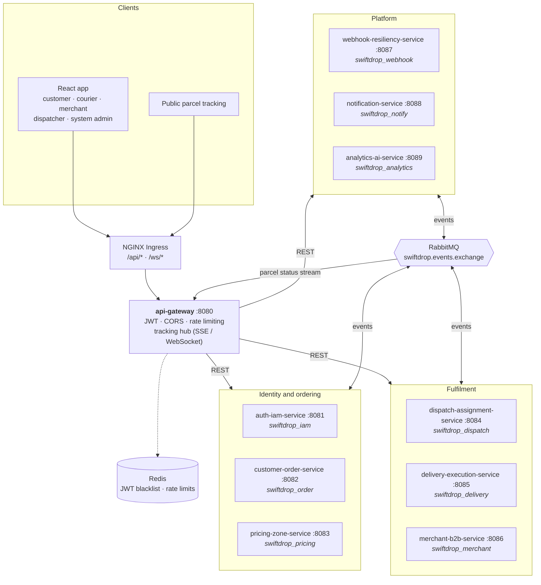
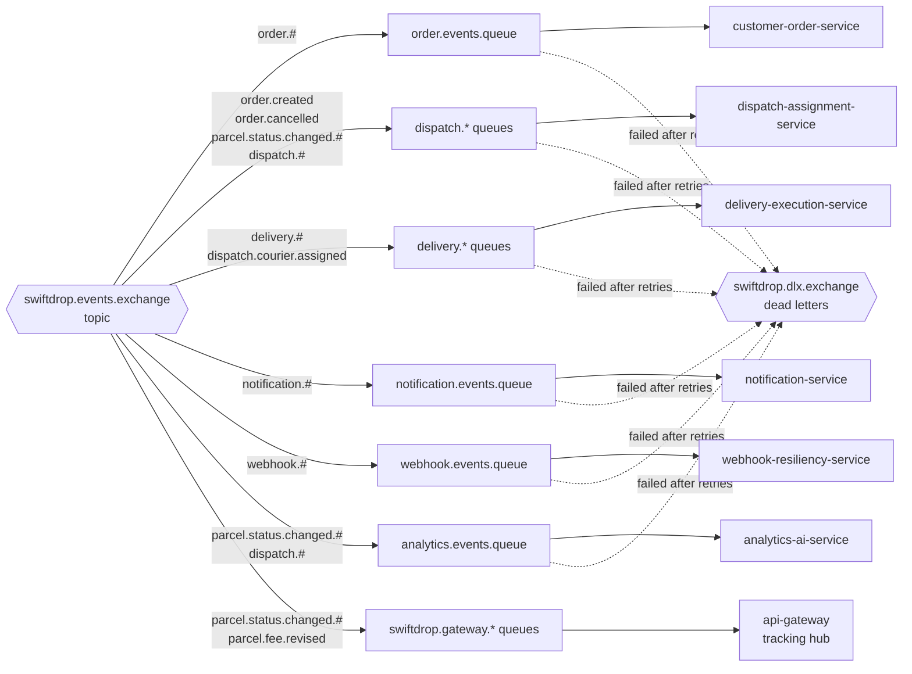
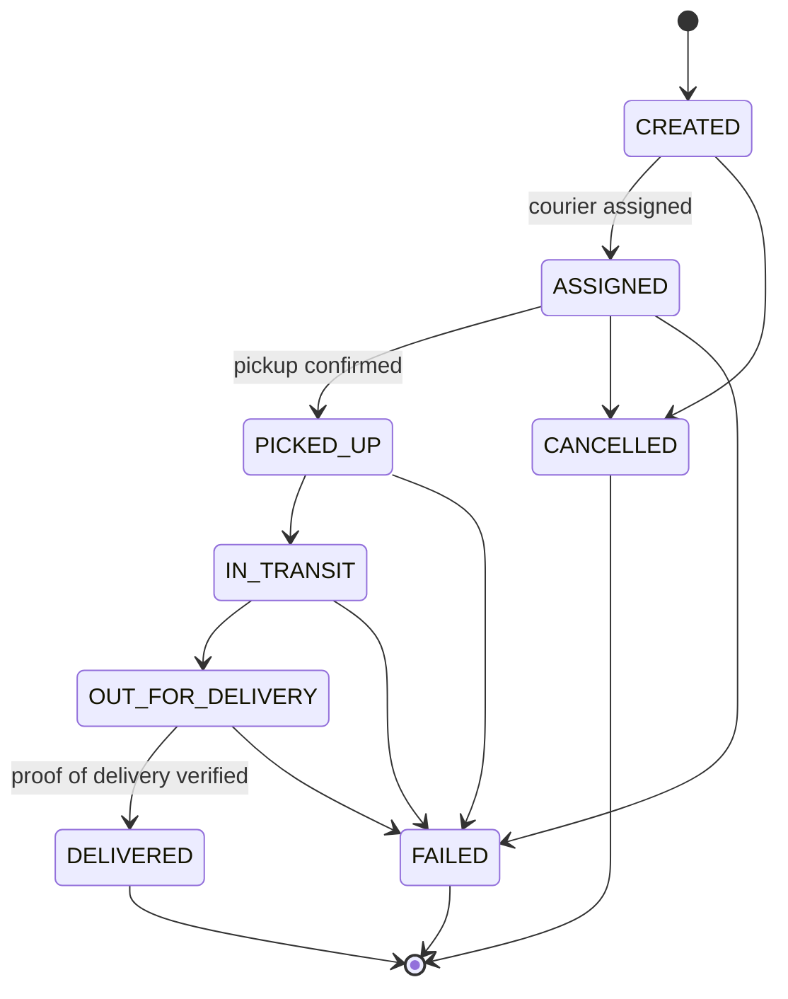
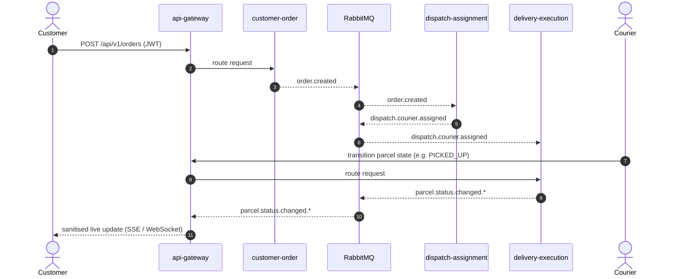
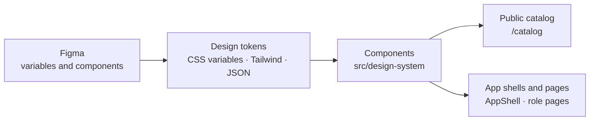
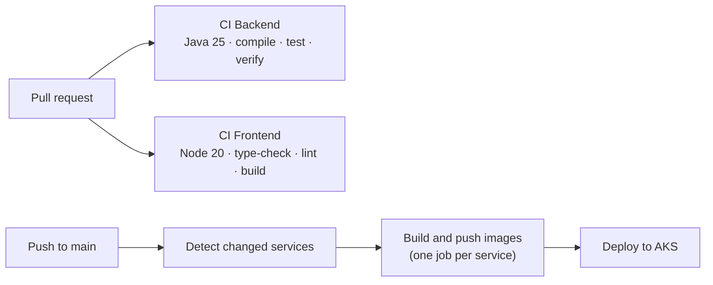

<div align="center">

# 🚀 SwiftDrop

### Enterprise Logistics & Courier Management Platform

**Event-driven microservices monorepo • Azure Kubernetes Service • Database-per-Service**

[](https://github.com/BitCraft-Org/SwiftDrop/actions/workflows/ci-backend.yml)
[](https://github.com/BitCraft-Org/SwiftDrop/actions/workflows/ci-frontend.yml)
[](https://github.com/BitCraft-Org/SwiftDrop/actions/workflows/cd-aks-deploy.yml)


</div>

---

## Contents

[Overview](#overview) · [Architecture](#architecture) · [Services and databases](#services-and-databases) · [Events](#event-driven-messaging) · [Parcel lifecycle](#parcel-lifecycle) · [Frontend](#frontend) · [Repository layout](#repository-layout) · [Quick start](#quick-start) · [CI/CD](#cicd) · [Documentation](#documentation) · [Contributing](#contributing)

## Overview

SwiftDrop manages the full life of a courier parcel across Sri Lanka: booking, pricing, dispatch, pickup, delivery with proof of delivery, cash handling, notifications and analytics.

| | |
|---|---|
| **Backend** | Java 25, Spring Boot 3.5, Spring Cloud Gateway (reactive), nine servlet services, Flyway, SpringDoc OpenAPI 3.1 |
| **Messaging** | RabbitMQ topic exchange with dead-letter queues |
| **Data** | PostgreSQL, one physically separate database per service. Redis for JWT blacklist and rate limits |
| **Frontend** | React 18, TypeScript, Vite, Tailwind. One app for five roles, built on the Velocity design system |
| **Platform** | Docker Compose locally, Azure Kubernetes Service (AKS) in production |

## Architecture

Every bounded context owns its schema, lifecycle and data. Services never read each other's databases; they talk through the gateway (HTTP) and RabbitMQ (events).



> [!NOTE]
> The browser only ever talks to the gateway (`http://localhost:8080/api/v1/...`). Downstream service ports are for local debugging, not for the frontend.

## Services and databases

| Service | Port | Database | Local DB port | K8s StatefulSet | Storage | Responsibility |
|---|---:|---|---:|---|---|---|
| `api-gateway` | 8080 | none (stateless) | n/a | n/a | n/a | Routing, JWT and header propagation, CORS, rate limiting, tracking hub |
| `auth-iam-service` | 8081 | `swiftdrop_iam` | 5431 | `iam-postgres` | 10Gi Std SSD | Authentication, identity, roles |
| `customer-order-service` | 8082 | `swiftdrop_order` | 5433 | `order-postgres` | 50Gi Prem SSD | Customer order lifecycle |
| `pricing-zone-service` | 8083 | `swiftdrop_pricing` | 5434 | `pricing-postgres` | 10Gi Std SSD | Pricing quotes, geofence zones |
| `dispatch-assignment-service` | 8084 | `swiftdrop_dispatch` | 5435 | `dispatch-postgres` | 20Gi Prem SSD | Courier availability and assignment |
| `delivery-execution-service` | 8085 | `swiftdrop_delivery` | 5436 | `delivery-postgres` | 50Gi Prem SSD | Delivery state machine, proof of delivery, location events |
| `merchant-b2b-service` | 8086 | `swiftdrop_merchant` | 5437 | `merchant-postgres` | 50Gi Prem SSD | Merchant APIs, API keys, order ingestion |
| `webhook-resiliency-service` | 8087 | `swiftdrop_webhook` | 5438 | `webhook-postgres` | 30Gi Prem SSD | Webhook subscriptions, retries, dead-letter replay |
| `notification-service` | 8088 | `swiftdrop_notify` | 5439 | `notify-postgres` | 20Gi Std SSD | Notification preferences and logs |
| `analytics-ai-service` | 8089 | `swiftdrop_analytics` | 5440 | `analytics-postgres` | 50Gi Prem SSD | Operational KPIs, AI delivery assistant |

Shared event records, DTO wrappers, enums and security headers live in [`backend/common-contracts`](backend/common-contracts). See [ADR-001](docs/architecture/ADR-001-physical-db-statefulsets.md) for why every database is its own StatefulSet.

## Event-driven messaging

Services publish to one topic exchange, `swiftdrop.events.exchange`. Each consumer binds its own queue by routing key. Messages that keep failing are dead-lettered to `swiftdrop.dlx.exchange` (`dlq.*` queues) so nothing is silently lost.



The queue, exchange and binding definitions for local development are in [`infra/local/rabbitmq/definitions.json`](infra/local/rabbitmq/definitions.json). Keep that file, the owning `RabbitMQConfig.java` and the event records in `common-contracts` in sync.

## Parcel lifecycle

The delivery service owns the state machine. Only allowed transitions are accepted, and `DELIVERED` needs verified proof of delivery (recipient OTP or signature).



Customers see a friendlier set of **nine public statuses**. They map one to one with the states above, with two differences: `ASSIGNED` is shown as `PICKUP_ASSIGNED`, and `RETURNED_TO_SENDER` exists only as a public status (the delivery state machine has no return state).

How a booking flows through the system:



## Frontend

One React app serves five roles. After sign-in, `AppShell` picks the matching layout: a side navigation and top bar on desktop, and a bottom tab bar on mobile for customers and couriers.

| Role | Density | Shell | Typical screens |
|---|---|---|---|
| Customer | Comfortable (44px controls) | Side nav, mobile tabs | Book, track |
| Courier | Kinetic (56px thumb targets) | Side nav, mobile tabs | Shift, active delivery |
| Merchant | Compact (34px) | Side nav | Dashboard, webhooks |
| Dispatcher | Compact | Side nav | Control tower, webhook dead letters |
| System admin | Compact | Side nav | Same ops screens today; admin screens are designed in Figma, not built yet |

### Velocity design system

The UI is built from the **Velocity** design system, which mirrors the [Figma file](https://www.figma.com/design/XX3u7zxTDat0l2MbG27niR/BitCraft-SwiftDrop-Web-Design--Copy-). The Figma file is the source of truth; the theme is **light only**.



- **Browse every component** at [`/catalog`](http://localhost:5173/catalog) once the frontend is running. It is public: no login and no backend needed. It is grouped like the Figma library, with a gallery that shows the shell of every role at desktop, tablet and mobile width.
- **Share the catalog as one file:** `npm run build:catalog` writes a single self-contained HTML file you can open from disk or send to someone.
- **Component rules and the full component map:** [`frontend/COMPONENTS.md`](frontend/COMPONENTS.md). Figma links: [`docs/velocity-design-system/figma-source.md`](docs/velocity-design-system/figma-source.md).

### Working on the frontend

```bash
cd frontend
npm install
npm run dev            # http://localhost:5173
npm run lint           # type-check
npm run build          # production build
npm run build:catalog  # single-file design catalog
npm run seed:demo      # create demo accounts per role (local only)
npm run api:sync:specs # regenerate API types from docs/api-specs
```

> [!TIP]
> No backend? Use **Continue in development mode** on the login page, then the *Dev persona* bar to switch roles. It uses a fake token, so API calls fail, but layouts and navigation work. For a real sign-in per role, run `npm run seed:demo`.

## Repository layout

```text
SwiftDrop/
├── backend/                     Maven reactor (Java 25, Spring Boot 3.5)
│   ├── common-contracts/        Shared events, DTOs, enums, headers
│   ├── api-gateway/             Routing, JWT, tracking hub
│   └── *-service/               Nine business services
├── frontend/                    Vite + React + TypeScript app
│   └── src/
│       ├── design-system/       Tokens, primitives, components, shells
│       ├── features/            customer · courier · merchant · admin-ops · auth · catalog
│       └── app/                 Router, AppShell, providers
├── infra/
│   ├── local/rabbitmq/          Queue, exchange and binding definitions
│   └── k8s/                     base · databases · messaging · services (AKS)
├── docs/                        API specs, ADRs, local guide, design system
├── .github/workflows/           CI and CD pipelines
├── docker-compose.yml           Local infrastructure and optional app containers
└── .env.example                 Environment variable template
```

## Quick start

**Prerequisites:** Java 25, Maven 3.9+, Node.js 20+, Docker Desktop.

```bash
# 1. Configure
cp .env.example .env

# 2. Start infrastructure (RabbitMQ, Redis and the 9 PostgreSQL databases)
docker compose up -d
docker compose ps

# 3. Run the frontend
cd frontend && npm install && npm run dev
```

To run services too, either start them from your IDE or Maven (see the [Local Development Guide](docs/LOCAL-DEVELOPMENT.md)), or use containers:

```bash
docker compose --profile apps up -d --build
```

> [!WARNING]
> The full stack is heavy: ten JVMs plus databases. With about 4 GB given to Docker the gateway was killed for lack of memory. Give Docker **6 GB or more**, or run only the services you need. Normal feature work needs just your service, its database and RabbitMQ.

| What | URL |
|---|---|
| Frontend | http://localhost:5173 |
| Design catalog | http://localhost:5173/catalog |
| API gateway | http://localhost:8080 |
| Swagger UI (all services) | http://localhost:8080/swagger-ui.html |
| RabbitMQ management | http://localhost:15672 (`swiftdrop` / `changeme_rabbit`) |

## CI/CD



Workflows are in [`.github/workflows`](.github/workflows). Deployment is incremental: only services that changed are rebuilt, and a manual run can target one service.

## Documentation

| Doc | What it covers |
|---|---|
| [Local Development Guide](docs/LOCAL-DEVELOPMENT.md) | Run one service, its database and the frontend |
| [API contracts](docs/api-specs/README.md) | OpenAPI documents, gateway routes, generating frontend types |
| [ADR-001](docs/architecture/ADR-001-physical-db-statefulsets.md) | Why every database is a separate StatefulSet |
| [Component guide](frontend/COMPONENTS.md) | Design system rules, components, catalog routes |
| [Design system source](docs/velocity-design-system/figma-source.md) | Figma file and node links |
| [Agent instructions](AGENTS.md) | Architecture boundaries and the change-sync checklist |

## Contributing

- Branch from `dev` and open pull requests into `dev`.
- Keep database ownership strict: no cross-service foreign keys, shared tables or direct database access.
- Changing a REST contract, event or database entity has required follow-up steps; see the matrix in [`AGENTS.md`](AGENTS.md).
- Before opening a frontend PR: `npm run lint` and `npm run build`.

## License

Copyright © 2026 BitCraft. All rights reserved.
