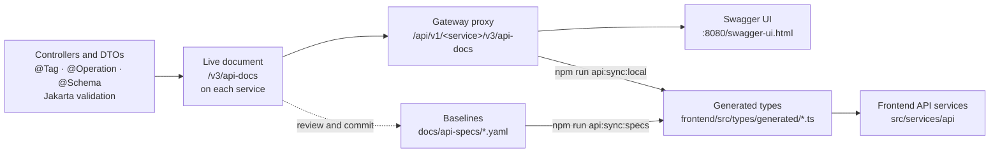
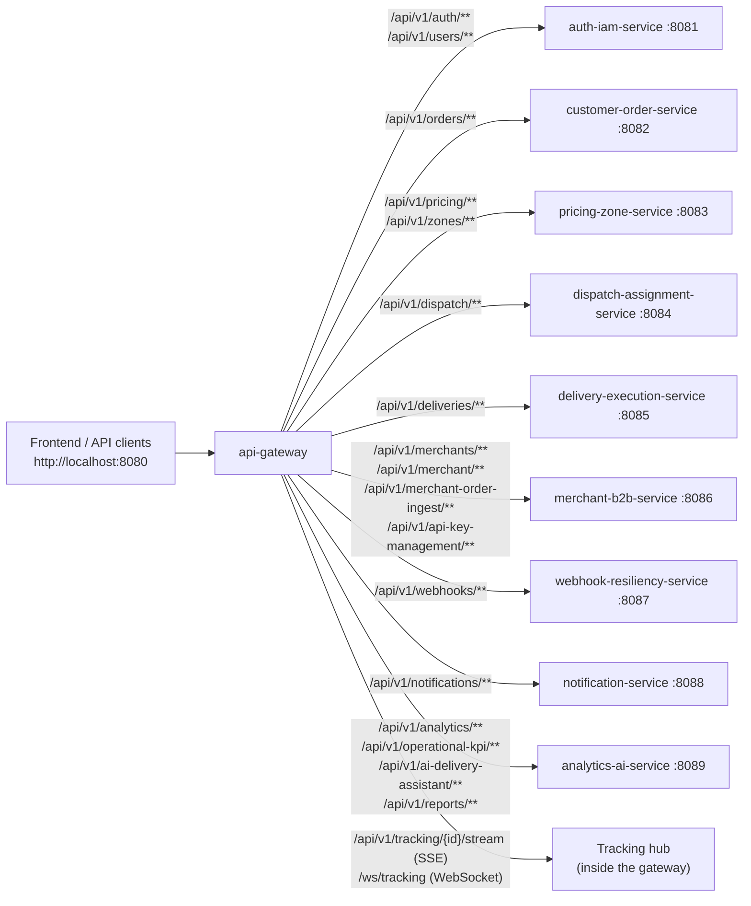
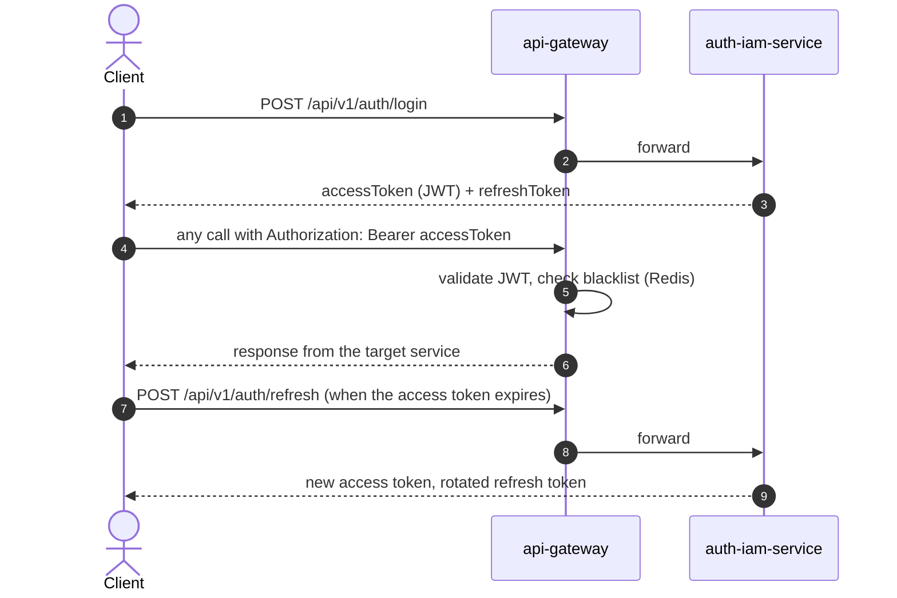
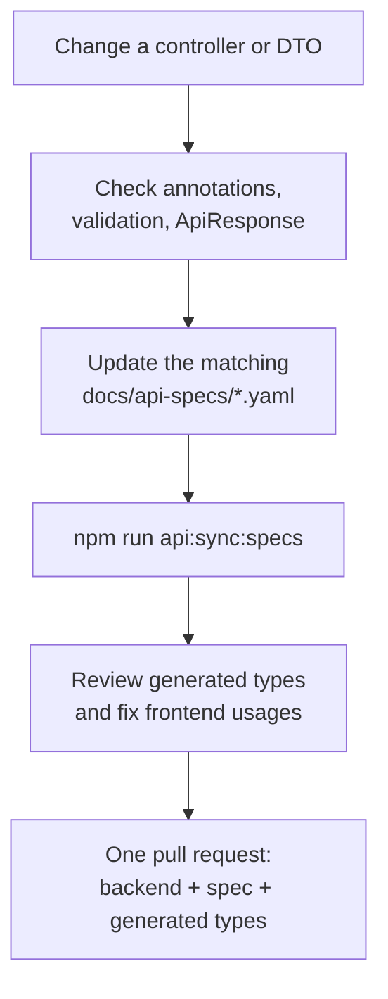

# SwiftDrop OpenAPI contracts

SwiftDrop exposes **one OpenAPI 3.1 document per service**, plus a public tracking contract for the API gateway. This folder holds the checked-in baselines. The frontend generates its TypeScript types from them, so they are the contract between backend and frontend.

| I want to... | Go to |
|---|---|
| Try endpoints in the browser | [Swagger UI](http://localhost:8080/swagger-ui.html) on a running gateway |
| See which URL reaches which service | [Gateway routes](#gateway-routes) |
| Find the document for a service | [Spec files](#spec-files) |
| Generate frontend types | [Frontend engineers](#frontend-engineers) |
| Change an endpoint or DTO | [Changing a contract](#changing-a-contract) |

## How the contracts flow



> [!IMPORTANT]
> Never hand-edit the generated TypeScript. Regenerate it, review the diff, and commit it together with the backend change.

## Gateway routes

The frontend never calls a service port directly. Every request goes through the gateway on `:8080`, which validates the JWT and forwards the request.



Routes are defined in `GatewayRoutesConfig.java` in [`backend/api-gateway`](../../backend/api-gateway). If you change one, update the JWT filter, the Swagger URL list and the frontend client in the same pull request.

## Spec files

| File | Service | Port | Live document through the gateway |
|---|---|---:|---|
| `api-gateway.yaml` | API gateway: public tracking (SSE, WebSocket) | 8080 | `/v3/api-docs` |
| `auth-iam-service.yaml` | Authentication, identity, roles | 8081 | `/api/v1/iam/v3/api-docs` |
| `customer-order-service.yaml` | Customer orders | 8082 | `/api/v1/orders/v3/api-docs` |
| `pricing-zone-service.yaml` | Pricing quotes, zones | 8083 | `/api/v1/pricing/v3/api-docs` |
| `dispatch-assignment-service.yaml` | Dispatch and courier assignment | 8084 | `/api/v1/dispatch/v3/api-docs` |
| `delivery-execution-service.yaml` | Delivery state machine, proof of delivery | 8085 | `/api/v1/deliveries/v3/api-docs` |
| `merchant-b2b-service.yaml` | Merchant APIs, API keys, ingestion | 8086 | `/api/v1/merchants/v3/api-docs` |
| `webhook-resiliency-service.yaml` | Webhook subscriptions, retries, replay | 8087 | `/api/v1/webhooks/v3/api-docs` |
| `notification-service.yaml` | Notification preferences and logs | 8088 | `/api/v1/notifications/v3/api-docs` |
| `analytics-ai-service.yaml` | KPIs, reports, AI assistant | 8089 | `/api/v1/analytics/v3/api-docs` |

The baselines are YAML. Each service also serves its live document as JSON at `/v3/api-docs`. The SpringDoc Maven plugin is declared in `backend/pom.xml` (plugin management) to export `<service>-openapi.json` into this folder, but no module runs it yet, so the YAML files are the source for type generation.

## Authentication

Most endpoints need a JWT in the `Authorization: Bearer <token>` header. The documentation endpoints are intentionally readable without a token.



- Access tokens are signed JWTs (1 hour by default). Refresh tokens are opaque, stored hashed, rotated on every use, and last 30 days by default.
- Anyone can self-register as `CUSTOMER` or `MERCHANT` with `POST /api/v1/auth/register`. `COURIER`, `DISPATCHER` and `SYSTEM_ADMIN` accounts can only be created by an admin with `POST /api/v1/users`.

Quick check against a local gateway:

```bash
curl -s -X POST http://localhost:8080/api/v1/auth/login \
  -H "Content-Type: application/json" \
  -d '{"username":"demo.customer","password":"Demo@12345"}'
```

To create the demo accounts, run `npm run seed:demo` in [`frontend`](../../frontend).

## Backend engineers

1. Start the services you need and open the central UI at [http://localhost:8080/swagger-ui.html](http://localhost:8080/swagger-ui.html). It lists every service.
2. Use **Authorize** to paste a JWT; the document endpoints themselves need no token.
3. Each service's raw document is at `http://localhost:<port>/v3/api-docs`.

Every endpoint should have `@Tag`, `@Operation` and `@Schema` annotations, Jakarta validation on request bodies, and the shared `ApiResponse<T>` wrapper.

## Frontend engineers

From [`frontend`](../../frontend/), install dependencies and generate types from the checked-in baselines:

```bash
npm install
npm run api:sync:specs
```

To generate from the running gateway instead:

```bash
npm run api:sync:local
```

Generated declarations are written to `frontend/src/types/generated/` (one file per service). Review the diff before committing it.

## QA engineers

- Use Swagger UI for interactive checks and the YAML baselines for contract review.
- Keep a running gateway **and** the downstream service available when you use **Try it out**, otherwise the gateway returns an error for that route.
- Public tracking can be checked with the SSE stream at `/api/v1/tracking/{trackingId}/stream` or the WebSocket at `/ws/tracking?trackingId={trackingId}`.

## Changing a contract



Checklist for the pull request:

- [ ] Controller and DTO annotations are complete
- [ ] The matching YAML baseline is updated
- [ ] Gateway route and JWT filter changed too, if the public path changed
- [ ] Generated types are regenerated (not hand-edited) and the frontend still builds (`npm run build`)
