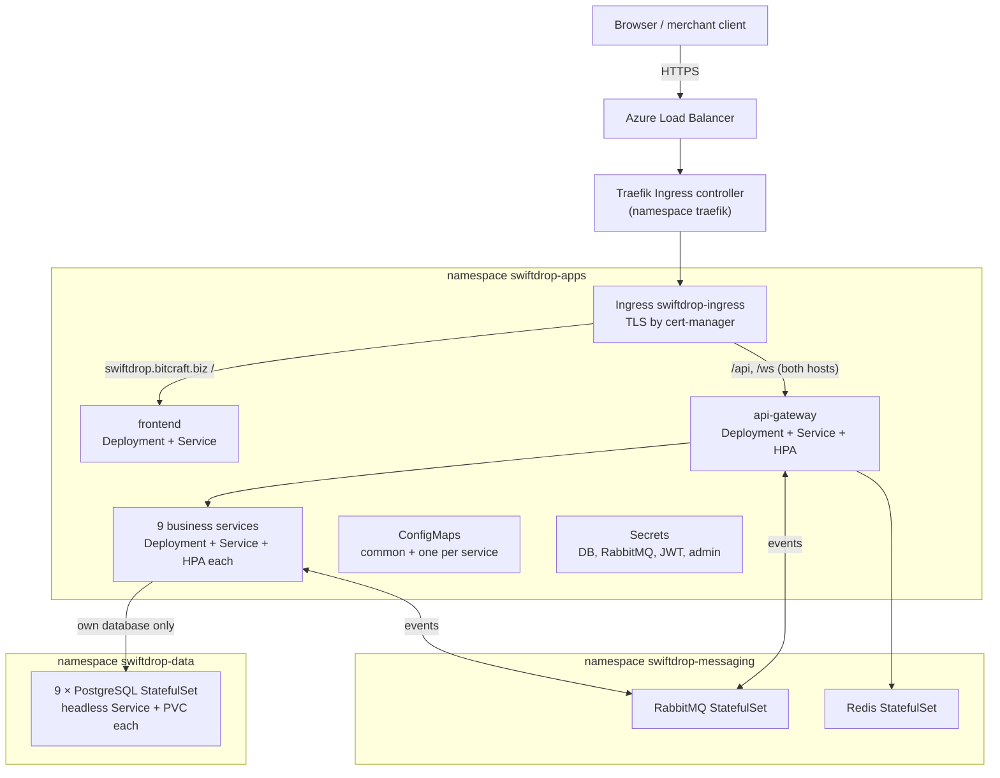

# Deploying SwiftDrop to Azure Kubernetes Service with Helm

This guide deploys the **whole system**: the frontend, the API gateway, the nine business services, nine PostgreSQL databases, RabbitMQ and Redis. Everything runs on AKS from one Helm chart, [`infra/helm/swiftdrop`](../../infra/helm/swiftdrop).

- Web app: `https://swiftdrop.bitcraft.biz`
- Public API and Swagger: `https://api.swiftdrop.bitcraft.biz`

## Contents

1. [What gets deployed](#1-what-gets-deployed)
2. [Assignment requirements → where they live](#2-assignment-requirements--where-they-live)
3. [Profiles: student vs production](#3-profiles-student-vs-production)
4. [Prerequisites](#4-prerequisites)
5. [Step 1 — Create the Azure resources](#5-step-1--create-the-azure-resources)
6. [Step 2 — Install the cluster add-ons](#6-step-2--install-the-cluster-add-ons)
7. [Step 3 — Point DNS at the cluster](#7-step-3--point-dns-at-the-cluster)
8. [Step 4 — Generate the secrets](#8-step-4--generate-the-secrets)
9. [Step 5 — Connect GitHub Actions to Azure](#9-step-5--connect-github-actions-to-azure)
10. [Step 6 — First deployment](#10-step-6--first-deployment)
11. [Day-to-day operations](#11-day-to-day-operations)
12. [Troubleshooting](#12-troubleshooting)
13. [Known limitations](#13-known-limitations)

## 1. What gets deployed



| Host | Path | Goes to |
|---|---|---|
| `swiftdrop.bitcraft.biz` | `/` | frontend (React build served by nginx) |
| `swiftdrop.bitcraft.biz` | `/api`, `/ws` | api-gateway. Same origin as the app, so the browser needs no CORS |
| `api.swiftdrop.bitcraft.biz` | `/api`, `/ws`, `/swagger-ui*`, `/v3/api-docs`, `/webjars` | api-gateway, for merchant B2B integrations, webhooks and Swagger |

The gateway's `/actuator` endpoints are deliberately **not** exposed publicly. To reach them, use `kubectl port-forward`.

## 2. Assignment requirements → where they live

| Requirement | Kubernetes objects | Source |
|---|---|---|
| Frontend | `Deployment`, `Service`, `ConfigMap` `frontend-nginx-config` | [`templates/frontend.yaml`](../../infra/helm/swiftdrop/templates/frontend.yaml) |
| Backend services | 10 × `Deployment`, `Service`, `HorizontalPodAutoscaler`, `ServiceAccount` | [`templates/backend-services.yaml`](../../infra/helm/swiftdrop/templates/backend-services.yaml) |
| Database | 9 × PostgreSQL `StatefulSet` with headless `Service` and `PersistentVolumeClaim` (database-per-service) | [`templates/postgres.yaml`](../../infra/helm/swiftdrop/templates/postgres.yaml) |
| Broker | RabbitMQ `StatefulSet`, `Service` + headless `Service`, `ConfigMap` | [`templates/rabbitmq.yaml`](../../infra/helm/swiftdrop/templates/rabbitmq.yaml) |
| ConfigMaps | `swiftdrop-common-config`, `<service>-config` ×10, `rabbitmq-config`, `frontend-nginx-config` | `values.yaml` → `commonConfig`, `services.<name>.config` |
| Secrets | `<db>-postgres-credentials` ×9, `rabbitmq-credentials`, `swiftdrop-jwt-credentials`, `swiftdrop-bootstrap-admin`, optional OAuth/AI | [`templates/secrets.yaml`](../../infra/helm/swiftdrop/templates/secrets.yaml) |
| Service definitions | `ClusterIP` for every Deployment, headless for every StatefulSet | All templates |
| Ingress | `Ingress` with two hosts, TLS through a cert-manager `ClusterIssuer` | [`templates/ingress.yaml`](../../infra/helm/swiftdrop/templates/ingress.yaml), [`templates/cluster-issuer.yaml`](../../infra/helm/swiftdrop/templates/cluster-issuer.yaml) |
| Helm (bonus) | The whole chart: two profiles, checksum-triggered rollouts, CI lint and schema validation | [`infra/helm/swiftdrop`](../../infra/helm/swiftdrop), [`ci-helm.yml`](../../.github/workflows/ci-helm.yml) |

A few extras come with the chart:
- **NetworkPolicy:** `webhook-resiliency-service` only accepts traffic from the gateway.
- **Init containers:** each service waits until its database and broker accept connections.
- **Hardening:** every workload has its own ServiceAccount, with API tokens not mounted.

## 3. Profiles: student vs production

| | `values.yaml` (production) | `values.yaml` + `values-student.yaml` |
|---|---|---|
| Nodes | 3+ × 4–8 vCPU | **1 × Standard_B4ms** (4 vCPU / 16 GiB) |
| Replicas per service | 2, HPA 2 → 6–12 | 1, HPA 1 → 2 |
| Database storage | Azure Managed Disks (Premium/Standard SSD) | `local-path` (the node's own disk) |
| Requested CPU / memory | ~14.5 vCPU / ~15 GiB | ~1.7 vCPU / ~6 GiB |

**Why the student profile uses `local-path`:** a 4-vCPU Azure VM can attach at most **8** managed disks. SwiftDrop needs **11** volumes: 9 PostgreSQL, RabbitMQ and Redis. With local-path, the databases are still StatefulSets with PersistentVolumeClaims, but the data lives on the node's disk. That data survives pod restarts and node reboots. It is **lost if AKS replaces the node**, which is why the cluster below is created with automatic node upgrades turned off.

CD uses the student profile by default. To switch, set the GitHub repository variable `DEPLOY_PROFILE` to `production`.

## 4. Prerequisites

Install these on your machine:
- **Azure CLI** (`winget install Microsoft.AzureCLI`)
- **kubectl** (`az aks install-cli`)
- **Helm 3** (`winget install Helm.Helm`)
- **GitHub CLI** (`winget install GitHub.cli`)
- **Git Bash**, which ships with Git for Windows and provides `openssl`

You also need:
- An Azure subscription. Azure for Students works.
- Admin rights on the GitHub repository, so you can add secrets, variables and environments.
- Access to the DNS settings of `bitcraft.biz`.

> [!IMPORTANT]
> Do **not** create the SwiftDrop namespaces or Secrets by hand with `kubectl`. The chart owns them. If a Secret or namespace already exists without Helm's ownership labels, Helm refuses to install.

## 5. Step 1 — Create the Azure resources

Run in **Git Bash**. Change the values in the first block if needed.

```bash
LOCATION=southeastasia          # Singapore; pick another region if your subscription policy blocks it
RG=rg-swiftdrop-prod
AKS=swiftdrop-aks
ACR=swiftdropacr$RANDOM         # must be globally unique, lowercase letters/digits only
echo "ACR name: $ACR"           # write this down

az login
az account show --query "{name:name, id:id}" -o table

# New subscriptions must register the resource providers once.
az provider register --namespace Microsoft.ContainerService --wait
az provider register --namespace Microsoft.ContainerRegistry --wait
az provider register --namespace Microsoft.ManagedIdentity --wait

# Check the vCPU quota (student subscriptions are usually ~4 per region).
az vm list-usage -l $LOCATION -o table | grep -Ei "Total Regional vCPUs|Standard BS Family"

az group create -n $RG -l $LOCATION
az acr create -g $RG -n $ACR --sku Basic

az aks create -g $RG -n $AKS -l $LOCATION \
  --tier free \
  --node-count 1 --node-vm-size Standard_B4ms \
  --node-osdisk-type Managed --node-osdisk-size 64 \
  --network-plugin azure --network-plugin-mode overlay --network-dataplane cilium \
  --auto-upgrade-channel none --node-os-upgrade-channel Unmanaged \
  --attach-acr $ACR \
  --generate-ssh-keys

az aks get-credentials -g $RG -n $AKS
kubectl get nodes
```

What the important flags do:
- **`--attach-acr`** lets the cluster pull images from your registry without an image pull secret.
- **`--network-dataplane cilium`** enforces the chart's NetworkPolicy. Without a policy engine, NetworkPolicies are ignored.
- **`--auto-upgrade-channel none --node-os-upgrade-channel Unmanaged`** stops AKS from re-imaging the node automatically, which would wipe `local-path` data. The OS still installs its own security updates. Upgrade the cluster deliberately when you choose to.

> [!TIP]
> **Saving credit.** The cluster costs money for every hour it runs. Stop it when you're not using it with `az aks stop -g $RG -n $AKS`, and start it again with `az aks start -g $RG -n $AKS`. Do one stop/start test early and confirm the database data is still there, before you rely on it for a demo.

If your ACR name is not `swiftdropacr`, set it as a repository variable:

```bash
gh variable set ACR_NAME --body "$ACR"
# Only if you changed them:
# gh variable set AKS_CLUSTER --body "$AKS"
# gh variable set AKS_RESOURCE_GROUP --body "$RG"
```

## 6. Step 2 — Install the cluster add-ons

These are installed once per cluster and are not part of the SwiftDrop chart. Pin the versions you install by adding `--version`; `helm search repo <chart>` lists them.

```bash
# 1. Storage for the student profile (skip for production: it uses Azure Disks).
#    Pin a released tag of rancher/local-path-provisioner.
kubectl apply -f https://raw.githubusercontent.com/rancher/local-path-provisioner/v0.0.30/deploy/local-path-storage.yaml
kubectl get storageclass local-path

# 2. Ingress controller (Traefik).
helm repo add traefik https://traefik.github.io/charts
helm repo update
helm upgrade --install traefik traefik/traefik -n traefik --create-namespace \
  -f infra/cluster/traefik-values.yaml

# 3. cert-manager (issues the Let's Encrypt certificate).
helm repo add jetstack https://charts.jetstack.io
helm repo update
helm upgrade --install cert-manager jetstack/cert-manager -n cert-manager --create-namespace \
  --set crds.enabled=true

kubectl get pods -n traefik
kubectl get pods -n cert-manager
```

**Why Traefik and not ingress-nginx:** the community ingress-nginx project stopped receiving releases in March 2026, and Azure's managed NGINX add-on loses support on 30 November 2026. The chart only uses standard Ingress fields, so it works with any controller.

## 7. Step 3 — Point DNS at the cluster

```bash
kubectl get svc traefik -n traefik    # copy EXTERNAL-IP
```

At the DNS provider for `bitcraft.biz`, add two **A** records pointing at that IP:

| Name | Type | Value |
|---|---|---|
| `swiftdrop` | A | `<EXTERNAL-IP>` |
| `api.swiftdrop` | A | `<EXTERNAL-IP>` |

Check the records with `nslookup swiftdrop.bitcraft.biz`. Let's Encrypt can only issue the certificate after both names resolve.

## 8. Step 4 — Generate the secrets

```bash
bash scripts/generate-helm-secrets.sh <your-email-for-letsencrypt>
```

This writes `infra/helm/swiftdrop/values-secrets.yaml`, which is git-ignored. It contains random passwords for the 9 databases and RabbitMQ, a fresh RS256 key pair (PKCS#8, as auth-iam-service requires), and the bootstrap admin login, which the script prints.

> [!WARNING]
> Keep a copy of this file somewhere safe, such as a password manager. PostgreSQL saves its password into the data volume on first start. If you regenerate the file later, the services can't log in to the existing databases.

Optional: to enable Google sign-in, fill in `googleOAuth`. Then register `https://swiftdrop.bitcraft.biz/api/v1/auth/oauth2/google/callback` as a redirect URI in Google Cloud Console.

## 9. Step 5 — Connect GitHub Actions to Azure

The pipeline logs in with **OpenID Connect**, so no Azure password is stored in GitHub. A user-assigned managed identity is used instead of an app registration. Student accounts often aren't allowed to create app registrations in a university tenant, but they can create managed identities.

```bash
REPO=$(gh repo view --json nameWithOwner -q .nameWithOwner)   # the repo whose Actions deploy
echo "Repo: $REPO"

az identity create -g $RG -n id-swiftdrop-github
CLIENT_ID=$(az identity show -g $RG -n id-swiftdrop-github --query clientId -o tsv)
PRINCIPAL_ID=$(az identity show -g $RG -n id-swiftdrop-github --query principalId -o tsv)

# Trust tokens from pushes to main (build jobs) and from the "production" environment (deploy job).
az identity federated-credential create -g $RG --identity-name id-swiftdrop-github \
  -n github-main --issuer https://token.actions.githubusercontent.com \
  --subject "repo:${REPO}:ref:refs/heads/main" --audiences api://AzureADTokenExchange
az identity federated-credential create -g $RG --identity-name id-swiftdrop-github \
  -n github-production --issuer https://token.actions.githubusercontent.com \
  --subject "repo:${REPO}:environment:production" --audiences api://AzureADTokenExchange

# Push images to ACR, and fetch AKS credentials.
az role assignment create --assignee-object-id $PRINCIPAL_ID --assignee-principal-type ServicePrincipal \
  --role AcrPush --scope $(az acr show -n $ACR --query id -o tsv)
az role assignment create --assignee-object-id $PRINCIPAL_ID --assignee-principal-type ServicePrincipal \
  --role "Azure Kubernetes Service Cluster User Role" --scope $(az aks show -g $RG -n $AKS --query id -o tsv)

# GitHub secrets.
gh secret set AZURE_CLIENT_ID --body "$CLIENT_ID"
gh secret set AZURE_TENANT_ID --body "$(az account show --query tenantId -o tsv)"
gh secret set AZURE_SUBSCRIPTION_ID --body "$(az account show --query id -o tsv)"
gh secret set HELM_SECRETS_VALUES < infra/helm/swiftdrop/values-secrets.yaml
```

Finally, create the `production` environment. In GitHub, go to **Settings → Environments → New environment** and name it `production`. Adding yourself as a required reviewer is a good idea, so every deploy waits for your approval.

## 10. Step 6 — First deployment

The pipeline only builds images that changed. Nothing exists in ACR yet, so the first run must build everything:

1. Merge this branch into `main`.
2. Go to **Actions → CD – AKS Deploy → Run workflow**, choose branch `main`, and set `target_service` to `all`.
3. Approve the `production` environment if you set up a reviewer.

The run builds 11 images in parallel and pushes them to ACR. It then runs `helm upgrade --install` with `--wait`. A cold start of ten JVMs on one node takes about 5–10 minutes.

Check the result:

```bash
kubectl get pods -n swiftdrop-data          # 9 × *-postgres-0   Running 1/1
kubectl get pods -n swiftdrop-messaging     # rabbitmq-0, redis-0
kubectl get pods,hpa -n swiftdrop-apps      # 10 services + frontend
kubectl get ingress -n swiftdrop-apps
kubectl get certificate -n swiftdrop-apps   # swiftdrop-tls   READY=True

curl -I https://swiftdrop.bitcraft.biz
curl https://api.swiftdrop.bitcraft.biz/api/v1/auth/.well-known/jwks.json
```

Then open `https://swiftdrop.bitcraft.biz` and sign in with the bootstrap admin.

**Deploying from your laptop instead.** Once the images exist in ACR, you can deploy without the pipeline:

```bash
helm upgrade --install swiftdrop infra/helm/swiftdrop -n default \
  -f infra/helm/swiftdrop/values-student.yaml \
  -f infra/helm/swiftdrop/values-secrets.yaml \
  --set global.imageRegistry=$ACR.azurecr.io \
  --set global.imageTag=<git-sha-that-CD-built> \
  --wait --timeout 20m
```

## 11. Day-to-day operations

| Task | Command |
|---|---|
| Deploy after a merge | Automatic on push to `main`. Only the changed components are rebuilt |
| Re-apply config only | Run the workflow with `target_service=none` |
| Change a non-secret setting | Edit `services.<name>.config` in `values.yaml` and merge. Pods roll automatically because of a checksum annotation |
| Rotate a secret | Edit `values-secrets.yaml`, run `gh secret set HELM_SECRETS_VALUES < …`, then run the workflow with `none` |
| Release history / rollback | `helm history swiftdrop -n default` · `helm rollback swiftdrop <revision> -n default` |
| Logs | `kubectl logs -n swiftdrop-apps deploy/customer-order-service -f` |
| Gateway health | `kubectl port-forward -n swiftdrop-apps svc/api-gateway 8080:8080`, then open `http://localhost:8080/actuator/health` |
| RabbitMQ UI | `kubectl port-forward -n swiftdrop-messaging svc/rabbitmq 15672:15672` |
| Database shell | `kubectl exec -it -n swiftdrop-data order-postgres-0 -- psql -U swiftdrop -d swiftdrop_order` |
| Stop / start (save credit) | `az aks stop -g $RG -n $AKS` · `az aks start -g $RG -n $AKS` |
| Remove the app | `helm uninstall swiftdrop -n default`. Namespaces and database volumes are kept on purpose |

### Adding an environment variable to a service

Follow the sync rule in [AGENTS.md](../../AGENTS.md):
1. Add it to `.env.example` and `docker-compose.yml`.
2. Add it to the Helm chart:
   - A **non-secret** value goes in `services.<name>.config` in [`values.yaml`](../../infra/helm/swiftdrop/values.yaml).
   - A **secret** goes in `services.<name>.secretEnv`, plus a new key in `templates/secrets.yaml`, `values-secrets.example.yaml` and `scripts/generate-helm-secrets.sh`.

## 12. Troubleshooting

| Symptom | Likely cause | Fix |
|---|---|---|
| `ImagePullBackOff` | ACR not attached, or the wrong `ACR_NAME` | `az aks update -g $RG -n $AKS --attach-acr $ACR`. Check the `ACR_NAME` variable |
| CD fails with "not deployed yet and was not built" | First run without `all` | Run the workflow with `target_service=all` |
| PVC `Pending`, pods `Pending` | `local-path` not installed, or the wrong storage class | Step 2.1. Then `kubectl describe pvc -n swiftdrop-data` |
| Pod `Pending: Insufficient cpu/memory` | Node too small, or the production profile on a student cluster | Use `values-student.yaml` and check `kubectl describe node` |
| Service stuck in `Init:0/1` | Its database or RabbitMQ isn't ready | `kubectl logs -n swiftdrop-apps <pod> -c wait-for-dependencies`. Then check the data or messaging pods |
| auth-iam `CrashLoopBackOff`: "RS256 requires configured RSA keys" | JWT keys missing or not PKCS#8 | Regenerate the keys with the script. The private key must start with `BEGIN PRIVATE KEY` |
| Services log "password authentication failed" | `values-secrets.yaml` was regenerated after the databases were created | Restore the original file. Otherwise delete that database's PVC (this **deletes its data**) |
| `Error: … invalid ownership metadata` | A namespace or Secret was created with `kubectl` | Delete that object, then run Helm again |
| `no matches for kind "ClusterIssuer"` | cert-manager isn't installed | Step 2.3 |
| Certificate not `READY` | DNS doesn't point at Traefik yet, or port 80 isn't reachable | `kubectl describe challenge -A`, and check both A records |
| Browser gets 404 from Traefik | Wrong host name, or the Ingress isn't admitted yet | `kubectl describe ingress -n swiftdrop-apps swiftdrop-ingress` |

## 13. Known limitations

- **Single node (student profile).** There's no high availability. If the node is replaced, the `local-path` data is lost. Back up anything important with `pg_dump`.
- **Proof-of-delivery files** are written to `/tmp/swiftdrop/pod` inside the `delivery-execution-service` container. This is the `POD_STORAGE_DIR` default. The files are lost when the pod restarts, and with more than one replica each pod only sees its own files. A durable fix needs shared storage (an Azure Files PVC, `ReadWriteMany`) or object storage such as Azure Blob.
- **HTTP is not redirected to HTTPS.** Let's Encrypt's HTTP-01 challenge needs plain HTTP. Add a Traefik redirect middleware after the certificate is issued if you want the redirect.
