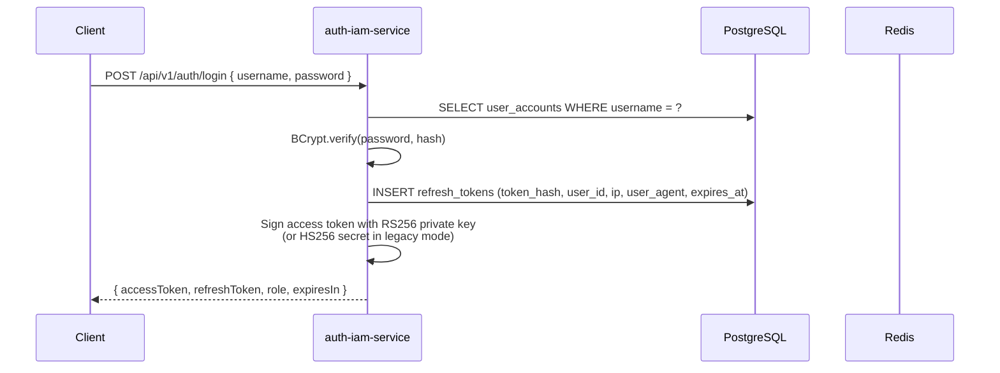
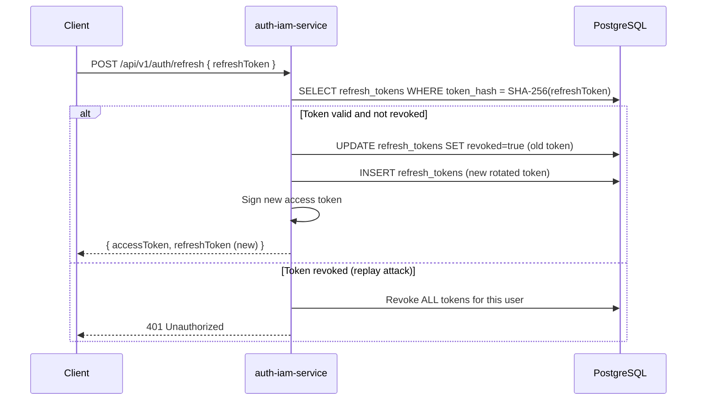
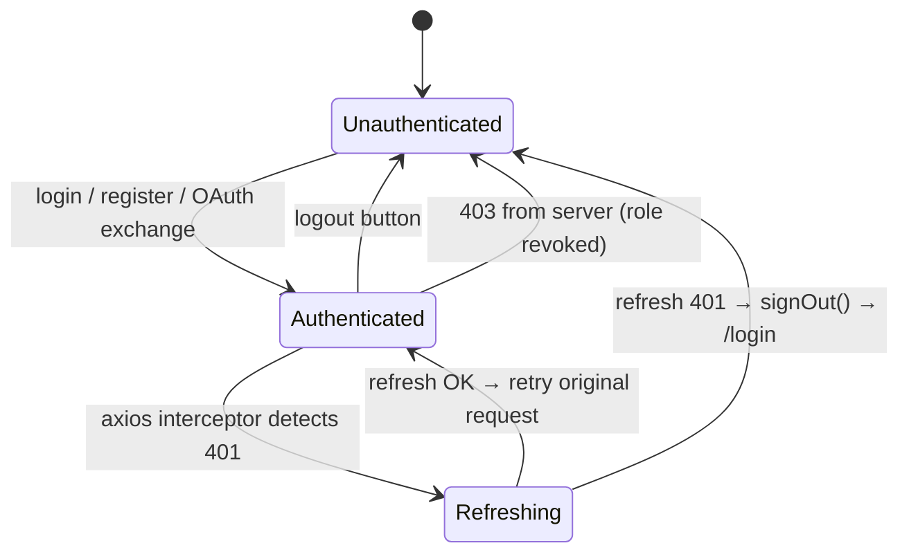

# JWT Lifecycle Specification — SwiftDrop IAM

> **Member 2 deliverable — Stage 20**  
> Documents how JWTs are issued, validated, rotated, and revoked in `auth-iam-service`.

## 1. Token Types

| Token | Algorithm | Lifetime | Storage (client) |
|---|---|---|---|
| **Access token** | RS256 (HS256 fallback if `JWT_ALGORITHM=HS256`) | 15 minutes (`swiftdrop.jwt.expiration-ms`) | In-memory only (Zustand store) |
| **Refresh token** | Opaque UUID | 7 days (`swiftdrop.jwt.refresh-expiration-ms`) | `localStorage` via Zustand persist |

## 2. Access Token Structure

```json
{
  "header": {
    "alg": "RS256",
    "kid": "swiftdrop-iam-rs256-v1",
    "typ": "JWT"
  },
  "payload": {
    "sub":        "<userPublicId UUID>",
    "jti":        "<random UUID — blacklist key>",
    "iat":        1700000000,
    "exp":        1700000900,
    "role":       "CUSTOMER",
    "district":   "COLOMBO",
    "merchantId": null,
    "iss":        "swiftdrop-iam"
  }
}
```

### Claim reference

| Claim | Type | Description |
|---|---|---|
| `sub` | UUID string | User's public identifier — stable across logins |
| `jti` | UUID string | Per-token unique ID; used as the Redis blacklist key |
| `iat` | NumericDate | Issue timestamp (Unix seconds) |
| `exp` | NumericDate | Expiry timestamp (Unix seconds) |
| `role` | enum string | `CUSTOMER` / `COURIER` / `DISPATCHER` / `MERCHANT` / `SYSTEM_ADMIN` |
| `district` | enum string | Sri Lankan district assigned to the account (nullable for CUSTOMER/MERCHANT) |
| `merchantId` | UUID string | Populated after a `merchant.approved` event; null for non-merchants |
| `iss` | string | Fixed issuer identifier `"swiftdrop-iam"` |

## 3. Token Issuance



## 4. Token Validation (per-request)

`JwtAuthenticationFilter` runs on every protected request:

```
Request
  │
  ▼
Extract "Authorization: Bearer <token>"
  │
  ▼
Verify signature (RS256 public key or HS256 secret)
  │  ← 401 on invalid signature
  ▼
Check exp claim
  │  ← 401 on expired token
  ▼
Redis: EXISTS jwt:<blacklist-prefix>:jti:<jti>
  │  ← 401 if blacklisted (logged-out / password-changed)
  ▼
Redis: EXISTS jwt:<blacklist-prefix>:user:<sub>
  │  ← 401 if entire user is blacklisted (email-changed / account suspended)
  ▼
DB: SELECT role FROM user_accounts WHERE public_id = sub
  │  ← 403 if DB role < JWT role (role demoted after token issue)
  ▼
Set SecurityContext principal with role, district, userId
  │
  ▼
Proceed to controller
```

## 5. Token Rotation (Refresh)



**Replay protection:** if the same refresh token is submitted twice, the second call detects the already-revoked token and immediately revokes **all** of that user's tokens, forcing a full re-login.

## 6. Token Revocation

### Logout

```
POST /api/v1/auth/logout { refreshToken }
  → DB: revoke refresh_token row
  → Redis: SET jwt:<prefix>:jti:<jti> = "1"  TTL = remaining access token lifetime
```

### Password change

```
POST /api/v1/auth/change-password { currentPassword, newPassword }
  → DB: UPDATE user_accounts SET password_hash = BCrypt(newPassword)
  → DB: Revoke ALL refresh_tokens for user
  → Redis: SET jwt:<prefix>:user:<sub> = "1"  TTL = access token max lifetime (15 min)
        (Invalidates all in-flight access tokens in one operation)
```

### Account suspension / email change (admin action)

```
PATCH /api/v1/users/couriers/{id}/status  { status: "SUSPENDED" }
  → DB: UPDATE user_accounts SET status = 'SUSPENDED'
  → DB: Revoke ALL refresh_tokens for user
  → Redis: SET jwt:<prefix>:user:<sub> = "1"  TTL = 15 min
```

## 7. JWKS Endpoint (RS256 mode)

The public key is published at:

```
GET /api/v1/auth/.well-known/jwks.json
```

Response:

```json
{
  "keys": [
    {
      "kty": "RSA",
      "use": "sig",
      "alg": "RS256",
      "kid": "swiftdrop-iam-rs256-v1",
      "n":   "<base64url modulus>",
      "e":   "AQAB"
    }
  ]
}
```

The gateway (Member 1) must whitelist this path and use it to validate tokens without calling the IAM service on every request.

> **Action required (Member 1):** Add `GET /api/v1/auth/.well-known/jwks.json` to `PUBLIC_PATHS` in `GatewayRoutesConfig.java` and switch `JwtAuthenticationGlobalFilter` to JWKS-based RS256 validation.

## 8. Frontend Token Lifecycle



- **Access token** is kept only in Zustand in-memory state (not persisted).  
- **Refresh token** is persisted in `localStorage` via Zustand-persist.  
- The axios interceptor in [`apiClient.ts`](../../frontend/src/services/api/apiClient.ts) handles single-flight refresh — concurrent requests queue behind one refresh call.

## 9. Environment Variables

| Variable | Description | Default |
|---|---|---|
| `JWT_SECRET` | HS256 signing secret (≥ 32 chars; ignored when RS256 active) | — |
| `JWT_ALGORITHM` | `HS256` or `RS256` | `HS256` |
| `JWT_EXPIRATION_MS` | Access token lifetime in ms | `900000` (15 min) |
| `JWT_REFRESH_EXPIRATION_MS` | Refresh token lifetime in ms | `604800000` (7 days) |
| `JWT_BLACKLIST_PREFIX` | Redis key namespace for token blacklists | `jwt:iam:` |

## 10. Related Files

| File | Purpose |
|---|---|
| [`TokenIssuanceService.java`](../../backend/auth-iam-service/src/main/java/com/swiftdrop/iam/service/TokenIssuanceService.java) | Sign, parse, verify, hash tokens |
| [`JwtKeyProvider.java`](../../backend/auth-iam-service/src/main/java/com/swiftdrop/iam/config/JwtKeyProvider.java) | RS256 key-pair generation/loading |
| [`JwksController.java`](../../backend/auth-iam-service/src/main/java/com/swiftdrop/iam/controller/JwksController.java) | JWKS public endpoint |
| [`JwtAuthenticationFilter.java`](../../backend/auth-iam-service/src/main/java/com/swiftdrop/iam/security/JwtAuthenticationFilter.java) | Per-request token validation |
| [`RefreshTokenService.java`](../../backend/auth-iam-service/src/main/java/com/swiftdrop/iam/service/RefreshTokenService.java) | Refresh token store & rotation |
| [`AuthenticationService.java`](../../backend/auth-iam-service/src/main/java/com/swiftdrop/iam/service/AuthenticationService.java) | Login, logout, password-change orchestration |
| [`apiClient.ts`](../../frontend/src/services/api/apiClient.ts) | Axios interceptor for silent refresh |
| [`useAuthStore.ts`](../../frontend/src/store/useAuthStore.ts) | Zustand auth state store |

