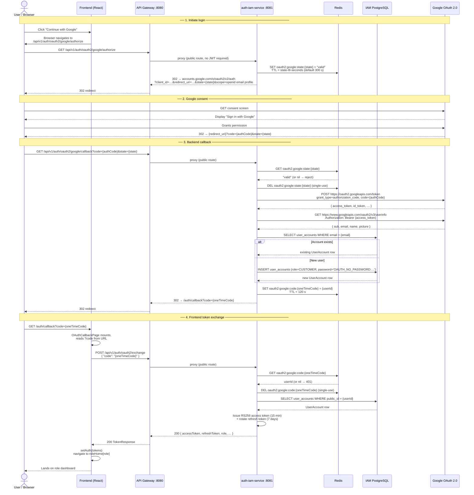

# Google OAuth 2.0 Sequence Diagram — SwiftDrop IAM

> **Member 2 deliverable — Stage 20**  
> Documents the Google OAuth 2.0 login flow as implemented in `auth-iam-service`.

## Flow Overview

SwiftDrop uses a **backend-driven OAuth 2.0 Authorization Code flow** with a two-redirect pattern.  
Tokens are **never** placed in URLs — the browser only ever receives a short-lived one-time code  
that it immediately exchanges via a secure `POST` to the IAM backend.

## Sequence Diagram



## Key Security Properties

| Property | Implementation |
|---|---|
| **CSRF protection** | PKCE-equivalent: `state` token is a random UUID stored in Redis with 5-minute TTL; validated and deleted on callback |
| **Token-free URLs** | Tokens never appear in redirect URIs — only a 2-minute one-time `code` is passed |
| **Single-use codes** | Both the `state` and exchange `code` are deleted from Redis on first use |
| **OAuth account isolation** | Password hash set to `OAUTH_NO_PASSWORD:{UUID}` — mathematically unreproducible; blocks password-based login |
| **New account role** | OAuth registrations always start as `CUSTOMER`; role promotion is an admin action |
| **Strict Mode safe** | `OAuthCallbackPage` uses an `exchanged` ref to guard against double-call in React Strict Mode |

## Configuration

```yaml
# application.yml / environment variables
swiftdrop:
  oauth2:
    google:
      client-id:     ${GOOGLE_CLIENT_ID}
      client-secret: ${GOOGLE_CLIENT_SECRET}
      redirect-uri:  ${GOOGLE_REDIRECT_URI:http://localhost:8081/api/v1/auth/oauth2/google/callback}
      state-ttl-seconds: 300   # 5 minutes
```

## Related Files

| File | Purpose |
|---|---|
| [`GoogleOAuthConfig.java`](../../backend/auth-iam-service/src/main/java/com/swiftdrop/iam/config/GoogleOAuthConfig.java) | `@ConfigurationProperties` binding |
| [`GoogleOAuthService.java`](../../backend/auth-iam-service/src/main/java/com/swiftdrop/iam/service/GoogleOAuthService.java) | Full flow implementation |
| [`AuthController.java`](../../backend/auth-iam-service/src/main/java/com/swiftdrop/iam/controller/AuthController.java) | `/authorize`, `/callback`, `/exchange` endpoints |
| [`SecurityConfig.java`](../../backend/auth-iam-service/src/main/java/com/swiftdrop/iam/config/SecurityConfig.java) | Permit-all rules for OAuth paths |
| [`OAuthCallbackPage.tsx`](../../frontend/src/features/auth/pages/OAuthCallbackPage.tsx) | Frontend code-exchange page |
| [`authApi.ts`](../../frontend/src/services/api/authApi.ts) | `exchangeOAuthCode()`, `googleAuthorizeUrl()` |

