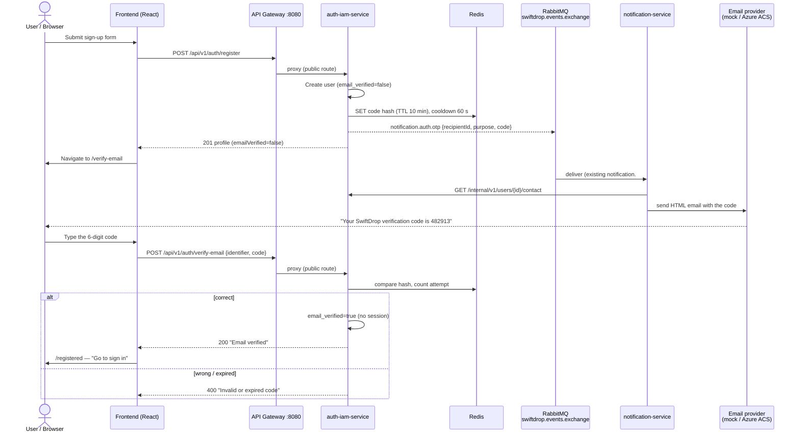
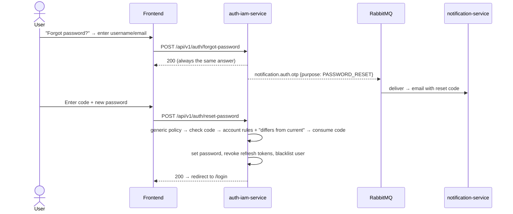

# Email Verification & Password Reset (One-Time Codes) — SwiftDrop IAM

> **Member 2 deliverable.** Documents the 6-digit email OTP flows implemented in `auth-iam-service`,
> emailed through `notification-service` (Member 9).

## Overview

| Flow | Trigger | Result |
|---|---|---|
| **Email verification** | `POST /api/v1/auth/register` (password sign-up) | Account starts with `email_verified = false`. Confirming the code via `POST /api/v1/auth/verify-email` verifies it. Registration **never signs the user in**: the frontend shows a *Successfully registered* page with a **Go to sign in** button. |
| **Password reset** | `POST /api/v1/auth/forgot-password` | `POST /api/v1/auth/reset-password` with the code sets a new password (which must differ from the current one) and **revokes every session**. |

Google sign-in already proves mailbox ownership, so Google accounts skip the OTP step. A **first-time** Google sign-in
creates the account and redirects to the same *Successfully registered* page (`/registered?method=google`) instead of
into the app; the user then signs in with Google. An existing account signs straight in.
Accounts that existed before migration `V5` and accounts created by an administrator are treated as verified.

## Sequence diagram — registration and verification

Password login for a still-unverified account returns `403` with `error: "EMAIL_NOT_VERIFIED"`
(only after the password was correct). The frontend then opens `/verify-email` and sends a fresh code.

## Password reset

## Security properties

| Concern | Control |
|---|---|
| Code generation | `SecureRandom`, 6 digits |
| Storage | Redis only, as a salted SHA-256 hash (`purpose:userId:code`), TTL 10 min. Never in PostgreSQL |
| Single use | Deleted on first successful check; a new code replaces the old one |
| Guessing | 5 wrong attempts destroy the code (HTTP 429); expiry 10 min |
| Send abuse | 60 s cooldown and 5 codes/hour per user and purpose; 30 requests/hour per client IP |
| Account enumeration | `resend-verification` and `forgot-password` always return 200; unknown accounts get the same `Invalid or expired code` |
| Redis down | **Fails closed** — no code is issued or accepted (503) |
| Pre-registration hijack | A repeat sign-up for an unverified email replaces the pending details. If the owner later signs in with Google, the pending password is discarded |
| Session safety | Password reset revokes all refresh tokens and blacklists existing access tokens |
| Password policy | 8–72 chars, a letter and a digit, not a common breached password, not containing the username or email name (NIST SP 800-63B style). A reset must differ from the current password |
| Reset as an oracle | Account-specific feedback (contains your username/email, same as current password) is only given after a valid code, so the endpoint cannot be used to probe an email address or guess a password. A rejected password does not consume the code |
| Revocation cutoff at the gateway | IAM writes `jwt:blacklist:user:<id>` = an ISO timestamp on password reset/change, role/status change and refresh-token replay. The gateway compares it with the token's `sessionIssuedAt` via `JwtSessionRevocation` (same rule as IAM): older tokens are rejected, sessions started afterwards work. (Previously the gateway treated the key's mere existence as revocation, locking the user out for up to an hour after a reset.) |
| Real client IP | The gateway's `ClientIpResolutionFilter` reads `X-Forwarded-For` right to left, skips trusted proxies (`GATEWAY_TRUSTED_PROXIES`, default private ranges) and rewrites `X-Forwarded-For`/`X-Real-IP` to that single address. Before, a client calling the gateway directly could send a fake IP each time and bypass every per-IP limit |
| Password guessing | Login lockout per account + IP (5 failures / 15 min) **and** per account across all IPs (20 / 15 min, stops credential stuffing from many addresses). Unknown usernames still run one bcrypt check, so response time does not reveal which accounts exist |
| Sign-out | Asks for confirmation. If the access token expired, the client refreshes and then revokes the **new** refresh token (it used to revoke the already-rotated one, leaving the new one valid) |
| Secret on the bus | `code` is in the event payload (needed to email it). `AuthOtpRequestedEvent.toString()` masks it; notification-service never logs the payload |
| Secret at rest in notification-service | Dispatch log stores `[redacted: contains a one-time security code]`; **no** in-app inbox row; the user's "email off" preference is ignored for these templates |
| Abandoned sign-ups | `UnverifiedAccountCleanupJob` (03:30 daily) deletes accounts unverified for more than 72 h |

## Messaging contract

| Item | Value |
|---|---|
| Exchange | `swiftdrop.events.exchange` |
| Routing key | `notification.auth.otp` (`EventRoutingKeys.AUTH_OTP_REQUESTED`) — deliberately under `notification.` so the existing `notification.#` binding delivers it; no `definitions.json` change |
| Payload | `AuthOtpRequestedEvent { eventId, correlationId, recipientId, purpose, code, expiresInMinutes, timestamp }` in `common-contracts` |
| Publisher | `AuthOtpPublisher` — sends **after commit**; a broker failure is logged, and the user can press *Resend* |
| Consumer | `AuthOtpTrigger` → templates `EMAIL_VERIFICATION` / `PASSWORD_RESET` (seeded by notification `V6`, with code fallbacks) |

## Endpoints

| Method | Path | Auth | Notes |
|---|---|---|---|
| POST | `/api/v1/auth/register` | public | Now returns an **unverified** profile and emails a code |
| POST | `/api/v1/auth/verify-email` | public | `{identifier, code}` → 200 message (no session; the user signs in next) |
| GET | `/api/v1/auth/username-availability?username=` | public | Live check for the sign-up form → `{username, available, reason: TAKEN\|INVALID}`. Case-insensitive, pending sign-ups hold their name, 60 checks/min per IP. The `lower(username)` unique index stays the authority (`/register` → 409) |
| POST | `/api/v1/auth/resend-verification` | public | `{identifier}` → always 200 |
| POST | `/api/v1/auth/forgot-password` | public | `{identifier}` → always 200 |
| POST | `/api/v1/auth/reset-password` | public | `{identifier, code, newPassword}` |

All new public paths (including `username-availability`) are whitelisted in the gateway's `JwtAuthenticationGlobalFilter` and IAM's `SecurityConfig`.

## Configuration

| Setting | Default | Purpose |
|---|---|---|
| `swiftdrop.auth.otp.ttl-minutes` | 10 | Code lifetime |
| `swiftdrop.auth.otp.max-attempts` | 5 | Wrong guesses before the code is destroyed |
| `swiftdrop.auth.otp.resend-cooldown-seconds` | 60 | Gap between codes |
| `swiftdrop.auth.otp.max-sends-per-hour` | 5 | Per user and purpose |
| `swiftdrop.auth.otp.ip-max-requests-per-hour` | 30 | Per client IP |
| `AUTH_OTP_LOG_CODE` | `false` | **Dev only** — logs the plaintext code so the flow works with the `mock` email provider |
| `swiftdrop.auth.otp.unverified-retention-hours` | 72 | Clean-up age for never-verified sign-ups |

To receive real codes locally set `NOTIFICATION_EMAIL_PROVIDER=azure` (with the `ACS_EMAIL_*` values) **and**
`CONTACT_MODE=iam`; with the default `CONTACT_MODE=fake` the email would be addressed to a placeholder.

## Frontend routes

`/verify-email` · `/registered` · `/forgot-password` · `/reset-password` (all public). Sign-up redirects to
`/verify-email?identifier=<email>`, and a correct code leads to `/registered`; an unverified login redirects to
`/verify-email?identifier=<username|email>&resend=1`. New-password fields show a strength meter that mirrors the
server policy.
