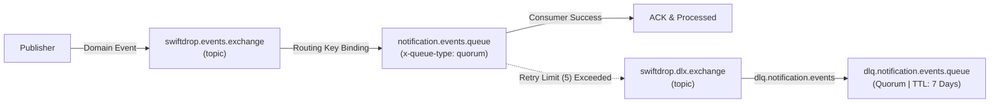
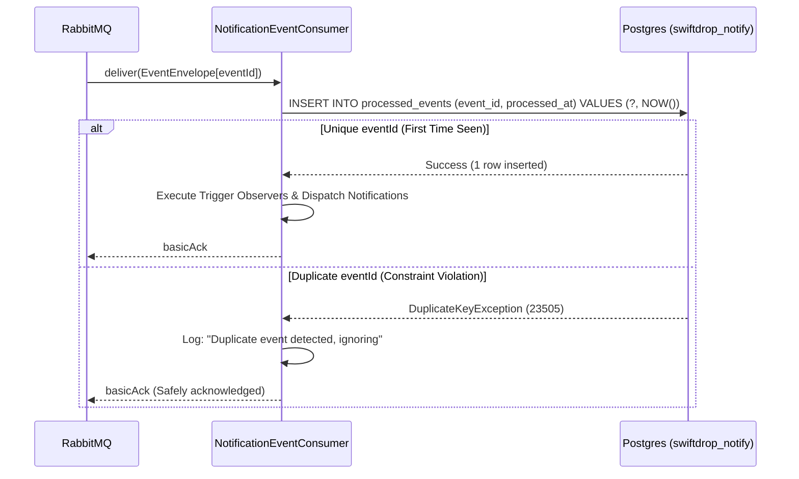
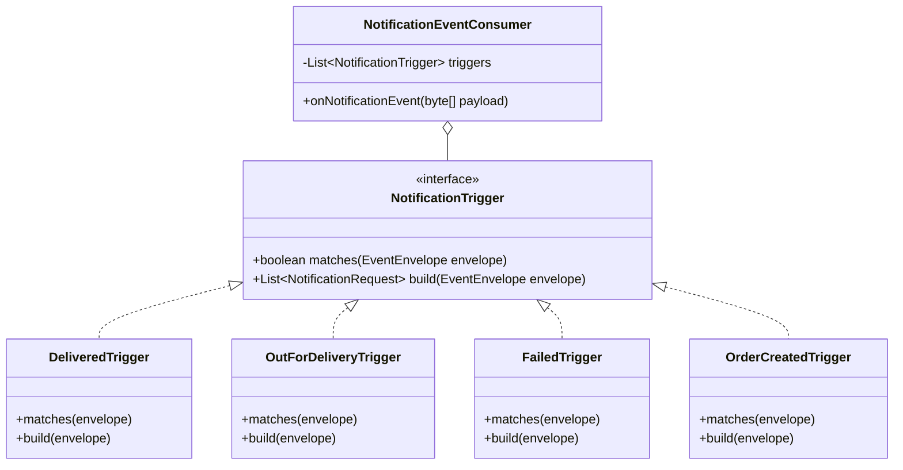

# Member 9: Publish/Subscribe Architecture & Notification System Specification

> **Author:** Member 9 (Umesh) — Asynchronous Event Broker, Pub/Sub & Notification Specialist  
> **Service Ownership:** `backend/notification-service` (:8088), `frontend/src/features/notifications/`  
> **Broker Core:** RabbitMQ 3.13 Quorum Queues on `swiftdrop.events.exchange`  
> **Database:** PostgreSQL Database-Per-Service (`swiftdrop_notify` on :5439)  
> **Documentation Deliverable:** Part D Master Design & Event Schema Specification

---

## 1. Table of Design Deliverables

| Deliverable | Format | Source / Link |
|---|---|---|
| **Broker Pub/Sub Topology Architecture** | Mermaid (.mmd) | [pubsub-broker-architecture.mmd](pubsub-broker-architecture.mmd) |
| **Notification Lifecycle Sequence Diagram** | Mermaid (.mmd) | [notification-sequence.mmd](notification-sequence.mmd) |
| **Notification System Use Case Diagram** | Mermaid (.mmd) | [notification-use-case.mmd](notification-use-case.mmd) |
| **Domain Event Payload Schema Specification** | Markdown & Tables | [event-payload-schemas.md](event-payload-schemas.md) |
| **Broker Topology Audit Matrix** | Markdown Reference | [docs/integration/broker-topology.md](../../integration/broker-topology.md) |
| **Real email via Azure Communication Services** | Setup & verification guide | [azure-email-notifications.md](azure-email-notifications.md) |
| **Test and coverage evidence** | Markdown, Surefire, JaCoCo | [docs/test-reports/m9](../../test-reports/m9/README.md) |

---

## 2. Publish / Subscribe Architectural Principles

### 2.1 Why a Topic Exchange? (`swiftdrop.events.exchange`)
SwiftDrop uses an AMQP **Topic Exchange** (`swiftdrop.events.exchange`) as the sole backbone for asynchronous inter-service domain communication.
1. **Dynamic Architectural Decoupling:** Producers (e.g. `delivery-execution-service` or `customer-order-service`) publish events to logical routing keys without any knowledge of which downstream microservices consume them.
2. **Selective Wildcard Routing:** Topic routing keys (`<entity>.<action>.<qualifier>`) enable consumers to bind with precision:
   - `notification-service` consumes status transitions (`parcel.status.changed.#`) and order creations (`order.created`).
   - `api-gateway` consumes tracking changes (`parcel.status.changed.#`) for live SSE/WebSocket streaming without handling order cancellations.
   - `analytics-ai-service` consumes all dispatch events (`dispatch.#`) and parcel changes (`parcel.status.changed.#`).
3. **High Throughput & Fanout:** Adding a new auditing, machine learning, or regulatory consumer requires **zero modifications** to existing publishers.

---

## 3. Quorum Queues, Reliability & Dead-Letter Strategy (DLX / DLQ)



### 3.1 High-Availability Quorum Queues
All service queues in SwiftDrop are configured as **Quorum Queues** (`x-queue-type: quorum`).
- Implements the Raft consensus algorithm across broker nodes.
- Eliminates data loss during broker crashes, network partitions, or node restarts.

### 3.2 Dead-Letter Exchange (DLX) & Replay Strategy
Every queue is bound with a dead-letter exchange configuration:
- `x-dead-letter-exchange`: `swiftdrop.dlx.exchange`
- `x-dead-letter-routing-key`: `dlq.<service-name>.events`
- `x-delivery-limit`: `5` attempts (enforced via broker policy `ha-quorum-queues`).

**Failure Handling Workflow:**
1. If an uncaught transient error or downstream timeout occurs, Spring AMQP rejects or NACKs the message with `requeue = true`.
2. When the redelivery count reaches **5**, RabbitMQ moves the message to `swiftdrop.dlx.exchange`.
3. The message lands in `dlq.notification.events.queue` with a 7-day TTL, where operations dispatchers can inspect the failure cause, repair data, and replay messages via Webhook Resiliency / DLQ consoles.

---

## 4. Idempotency & Deduplication Architecture

Network re-transmissions and broker failovers can cause duplicate message deliveries (at-least-once delivery semantics). SwiftDrop guarantees **exactly-once processing semantics** at the database boundary.



### Database-Level Idempotency (`V3__idempotent_events.sql`)
```sql
CREATE TABLE processed_events (
    event_id UUID PRIMARY KEY,
    processed_at TIMESTAMP WITH TIME ZONE NOT NULL DEFAULT CURRENT_TIMESTAMP
);
```
- **Atomicity:** The consumer uses the incoming event's `eventId` as the primary key.
- **Fast Rejection:** Attempting to process the same event twice triggers a primary key conflict (`DuplicateKeyException`), immediately halting downstream notifications without duplicate email transmissions.

---

## 5. Observer Pattern & Notification Trigger Pipeline

Rather than sprawling conditional logic (`if (status == ...)`) in the message listener, `notification-service` implements the **Observer Design Pattern**:



### Seeded Notification Templates
Notifications render using standardized, safe templates defined in `V1__init_notification.sql`:
1. `PARCEL_OUT_FOR_DELIVERY` &rarr; *"Your parcel {{trackingNumber}} is out for delivery with {{courierName}}."*
2. `PARCEL_DELIVERED` &rarr; *"Your parcel {{trackingNumber}} was delivered successfully."*
3. `PARCEL_FAILED` &rarr; *"Delivery attempt for {{trackingNumber}} failed. Reason: {{failureReason}}."*
4. `PARCEL_CREATED` &rarr; *"Your SwiftDrop order {{trackingNumber}} has been placed successfully."*

---

## 6. Zero-PII Event Bus & Privacy Masking Compliance

SwiftDrop enforces strict physical PII isolation across the messaging tier:

### 6.1 Zero PII in Domain Events
- Domain events **never** contain customer names, phone numbers, email addresses, or physical street addresses.
- Events carry only UUIDs (`customerId`, `merchantId`) and district codes (`SriLankanDistrict`).

### 6.2 IAM Contact Lookup & Resilient Caching (Stage 11)
- When a trigger fires, `ContactClient` calls Member 2's `auth-iam-service` at `/internal/v1/users/{id}/contact`.
- **Caffeine In-Memory Cache:** Cached for **10 minutes** to eliminate repetitive network hops.
- **Fallback Mode:** When `CONTACT_MODE=fake` (during network isolation or local tests), fallback contact details (`+94770000000`, `user@swiftdrop.lk`) are used safely.

### 6.3 PII Masking at the Dispatch Boundary (Stage 12 & 13)
All outbound dispatch logs and audit displays are masked using `PiiMasker`:
- **Phone Numbers:** `+94771234567` &rarr; `07X***4567`
- **Email Addresses:** `customer@example.com` &rarr; `c***@example.com`
- **Template Sanitization:** `TemplatePiiTest` ensures unknown placeholders render empty string `""` and passwords, credit card numbers, or full street addresses are never rendered.

---

## 7. Frontend Integration & Real-Time Inbox (PR 5)

Member 9 provides three integrated frontend interfaces:
1. **Header Notification Bell (`NotificationBell.tsx`):**
   - Mounted in `AppShell`'s `TopBar`.
   - Polls `/api/v1/notifications/me/unread-count` every 20 seconds using `@tanstack/react-query`.
   - Displays a dynamic badge counter for unread messages.
2. **Interactive Sliding Tray (`NotificationTray.tsx`):**
   - Click to reveal user notifications with status-tinted icons.
   - Clicking an alert marks it as read and navigates to `/customer/tracking/{trackingNumber}` or `/track/{trackingNumber}`.
   - "Mark all as read" button clears all notifications.
3. **Dispatcher Audit Console (`NotificationConsolePage.tsx` & `NotificationLogModal.tsx`):**
   - Mounted at `/ops/notifications` and via modal button on `FleetControlTowerPage.tsx`.
   - Displays masked recipient details, channel tags, template codes, and rendered content bodies.

---

## 8. Verification & Test Evidence Checklist

All six assigned tests pass cleanly:

| Test Class | Scope | What it proves | Verification Status |
|---|---|---|---|
| `BrokerNotificationIT` | Integration (RabbitMQ + Postgres) | End-to-end broker delivery: DELIVERED event creates dispatch log & in-app row | ✅ PASS |
| `OrderCreatedNotificationIT` | Integration | `order.created` event produces customer confirmation alert | ✅ PASS |
| `TemplatePiiTest` | Unit | Template renderer never leaks passwords, cards, full addresses, or phone numbers | ✅ PASS |
| `MaskingTest` | Unit | `PiiMasker` masks phones (`07X***5678`) and emails (`c***@example.com`) in logs | ✅ PASS |
| `DuplicateEventTest` | Unit | Idempotency: Duplicate `eventId` produces exactly one dispatch log | ✅ PASS |
| `DefinitionsJsonParityTest` | Unit | Verifies `definitions.json` contains all required queues, bindings, and exchanges | ✅ PASS |

---

## 9. Examiner Demonstration Walkthrough Script

During the final presentation / exam evaluation, follow these three steps:

### Step 1: Inspect RabbitMQ Broker Topology
1. Open RabbitMQ Management Console: **`http://localhost:15672`** (guest / guest).
2. Go to **Exchanges** &rarr; `swiftdrop.events.exchange`.
3. Show the bindings table: verify `parcel.status.changed.#` and `order.created` are bound to `notification.events.queue`.
4. Point out `swiftdrop.dlx.exchange` and quorum queues with delivery limit 5.

### Step 2: Trigger a Status Transition & Observe Notification Bell
1. Open the SwiftDrop app at **`http://localhost:5173`**.
2. Sign in as a Customer or navigate to `/customer/orders`.
3. When an order transitions to `OUT_FOR_DELIVERY` or `DELIVERED`:
   - Within 20 seconds, the **Notification Bell** in the header updates with an unread badge counter (`1`).
   - Click the bell to open the **Notification Tray**.
   - Show the package status update, click the alert to show that it marks read and deep-links directly to live tracking!

### Step 3: Show Dispatcher Audit Console & PII Masking
1. Switch persona to **`ADMIN_OPS`** (Dispatcher).
2. Click **"Notification logs"** in the sidebar (or navigate to `http://localhost:5173/ops/notifications`).
3. Show the dispatch audit record:
   - Recipient phone is masked (`07X***5678`).
   - Recipient email is masked (`c***@example.com`).
   - Template identifier: `PARCEL_DELIVERED`.
   - Status: `SENT`.
4. Click the row to inspect the rendered body in the audit inspector panel, proving zero PII leakage.

